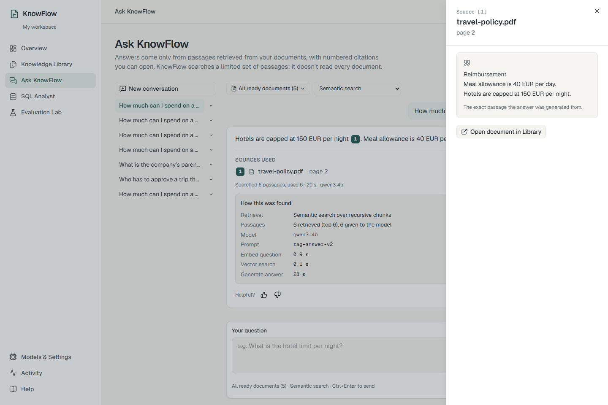
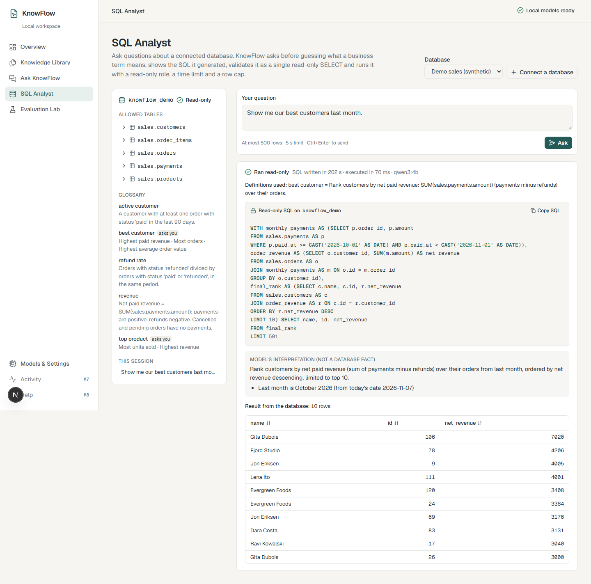
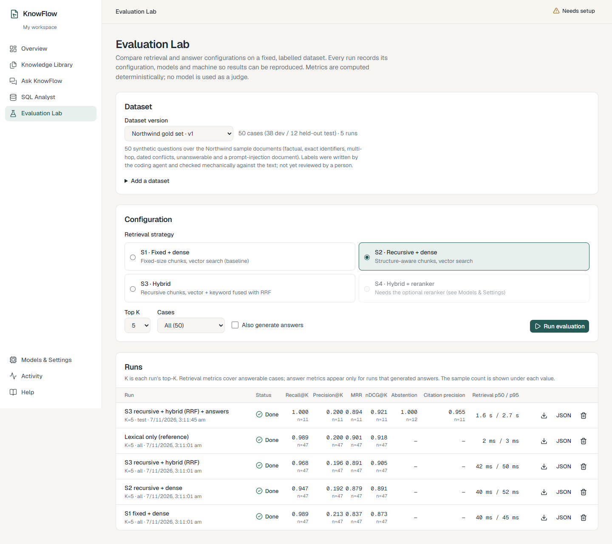
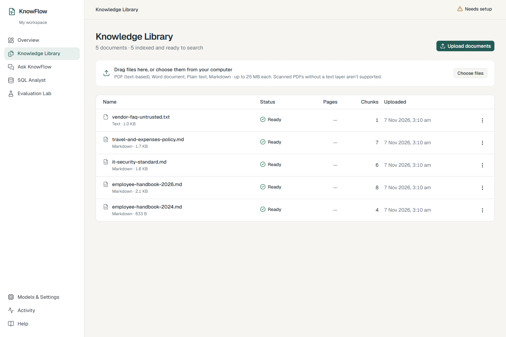

# KnowFlow

**Answers grounded in your knowledge.**

KnowFlow is a **local-first AI knowledge workspace**. You give it your documents, such as policies, handbooks,
manuals and FAQs, and you can then:

1. **Ask questions in plain English** and get answers with **numbered citations** that open the exact passage they came from.
2. **Ask business questions about a database** ("Who were our best customers last month?"). KnowFlow writes **safe,
   read-only SQL**, and asks you what an ambiguous term like *"best"* means **before** it guesses.
3. **Measure answer quality** in an evaluation lab, so you can tell whether a change to retrieval actually helped.

Everything runs **on your own computer**. The AI models run locally through [Ollama](https://ollama.com), so there's
**no paid API, no API key and no cloud model endpoint**
([ADR-007](docs/decisions/ADR-007-local-only-cost-boundary.md)). Your documents never leave your machine. Free model
weights still cost CPU/GPU time, RAM, disk space and electricity.

> **Developer:** Priyanshu Raj Mishra, B.Tech (ECE), BIT Mesra · [GitHub @priyanshu12-stack](https://github.com/priyanshu12-stack).
> See [About the developer](#about-the-developer).

---

## Table of contents

- [Screenshots](#screenshots)
- [Why KnowFlow?](#why-knowflow)
- [Features in detail](#features-in-detail)
- [How it works](#how-it-works)
- [Tech stack](#tech-stack)
- [Measured results](#measured-results)
- [Prerequisites](#prerequisites)
- [Installation and first run](#installation-and-first-run)
- [Using the app: a guided tour](#using-the-app-a-guided-tour)
- [Configuration](#configuration)
- [Testing and quality checks](#testing-and-quality-checks)
- [API reference](#api-reference)
- [Repository layout](#repository-layout)
- [Troubleshooting](#troubleshooting)
- [Glossary](#glossary)
- [Known limitations](#known-limitations)
- [Documentation](#documentation)
- [About the developer](#about-the-developer)

---

## Screenshots

| Ask with citations | SQL with clarification |
|---|---|
|  |  |
| **Evaluation Lab** | **Knowledge Library** |
|  |  |

More: [Overview](docs/screenshots/overview.png) · [SQL clarification](docs/screenshots/sql-clarification.png) ·
[per-case inspector](docs/screenshots/evaluation-case.png) · [Activity](docs/screenshots/activity.png) ·
[Models & Settings](docs/screenshots/settings.png).

Every screenshot shows the real app with real data, running on the reference machine (a laptop with 7.3 GB of RAM
and no GPU). The interface is responsive. It has been checked on every page at 12 screen widths from 320 px (small
phones) to 2560 px (large monitors), with no sideways scrolling. Below 1024 px the sidebar becomes a slide-out menu.

---

## Why KnowFlow?

Most "chat with your documents" tools have three problems:

| Problem | What KnowFlow does instead |
|---|---|
| **They make things up.** A language model will happily write a confident answer that no document supports. | Every `[n]` citation is **checked against the passages that were actually retrieved**. If the answer has no valid citation, KnowFlow doesn't show it and says *"No supporting source found"*. |
| **They send your data to the cloud.** Company documents go to a third-party API. | **Everything is local.** The models run in Ollama on your machine, and the database is your own PostgreSQL. |
| **Nobody knows whether they're any good.** Changes are judged by gut feeling. | The **Evaluation Lab** scores retrieval strategies on a labelled question set with standard metrics, and records every setting so runs can be repeated. |

For SQL, the extra risk is a model that writes a `DELETE`, or silently guesses what "best customer" means. KnowFlow
validates every query structurally, runs it with a role that **can only read**, and asks a clarifying question
whenever a business term is ambiguous.

---

## Features in detail

### 1. Knowledge Library: uploading and indexing documents

- **Supported formats:** PDF (text-based, not scanned), Word (DOCX), plain text (TXT) and Markdown (MD), up to 25 MB each.
- **Safe uploads.** Each file is checked four ways: extension, declared MIME type, the file's real signature (magic
  bytes) and size. Files are stored under generated names, never the name you uploaded, so a filename can't be used
  to escape the storage folder.
- **Sandboxed extraction.** Text is extracted in a separate child process with a time limit, so a malformed PDF can't
  freeze or crash the server. Page numbers (PDF) and heading paths (DOCX/Markdown) are kept, so citations can point
  to "page 4" or "Travel Policy > Accommodation".
- **Two chunking strategies.** Documents are cut into passages ("chunks") two ways: *fixed-size* windows with overlap,
  and *recursive* splitting that follows the document's structure. Both are stored so they can be compared.
- **Local embeddings.** Each chunk is turned into a vector by `nomic-embed-text:v1.5` and stored in PostgreSQL with
  pgvector.
- **Duplicates.** Uploading the same file again offers **skip**, **re-index** or **save as a new version**.
- **Background processing.** A worker process handles ingestion, so uploads return immediately. Progress, failures
  (explained in plain language) and a **Retry** button are shown in the library.

### 2. Ask KnowFlow: answers with verified citations

- **Three retrieval modes:** *semantic* (vector similarity), *keyword* (PostgreSQL full-text search) and *hybrid*,
  which merges both with **Reciprocal Rank Fusion (RRF)**.
- **Structured answers.** The local model (`qwen3:4b`) must reply in a fixed JSON schema: an answer plus the passage
  numbers it used.
- **Citation verification.** Every `[n]` must refer to a passage that was actually retrieved. Invalid citations are
  removed, and an answer left with none is replaced by an honest *"No supporting source found"* (abstention).
- **Click to verify.** Each citation opens a drawer with the exact source passage, document, page and section.
- **Prompt-injection resistant.** Text inside documents is treated as **data, never as instructions**. The sample
  corpus includes an "untrusted vendor FAQ" that tries to hijack the model, and the real model ignores it (this is
  covered by a test).
- **Conversations** are saved, and can be renamed and deleted. You can rate each answer as *helpful* or *not helpful*.

### 3. SQL Analyst: safe text-to-SQL

- Runs against the bundled **synthetic sales database** (customers, products, orders, order items, payments) or your
  own PostgreSQL database.
- **Clarify first.** A glossary marks terms such as "best customer" as ambiguous (by revenue? by order count?).
  KnowFlow asks you to choose **before** it writes any SQL, and shows which definitions and assumptions it used.
- **Several layers of safety:**
  1. The generated SQL is parsed into a syntax tree with **SQLGlot**. Only a **single `SELECT`** on **allow-listed
     schemas** is accepted. Writes, DDL, locks, system catalogs and dangerous functions are rejected.
  2. The query runs as a database role that **only has SELECT permission**.
  3. It runs inside a **read-only transaction**, with a **statement timeout** (5 s by default) and a **row cap** (500 by default).
- Connection passwords you add are **encrypted at rest** (Fernet) and never sent back to the browser.
- When the model writes invalid SQL, it fails safely with a clear message, and you can ask for one automatic repair.

### 4. Evaluation Lab: measuring quality

- Import a **gold set** (CSV or JSONL) of questions, each with the passages that answer it, or load the bundled
  50-question sample.
- Compare retrieval strategies on the same dataset:

  | Preset | Chunking | Retrieval |
  |---|---|---|
  | S1 | fixed | dense (vector) |
  | S2 | recursive | dense (vector) |
  | S3 | recursive | hybrid (vector + keyword, RRF) |
  | S4 | recursive | hybrid + cross-encoder reranker (optional, needs the reranker installed) |

- **Deterministic metrics,** with no AI judge: Recall@K, Precision@K, MRR, nDCG@K, abstention accuracy, citation
  precision, prompt-injection resistance and latency (p50/p95).
- **Reproducible.** Every run records its full configuration, model names and digests, and machine details.
  Runs can be resumed, inspected case by case, and exported as JSON or CSV.

### 5. Overview, Models & Settings, Activity, Help

- **Overview:** a readiness dashboard covering PostgreSQL, pgvector, the schema version, Ollama, both models and the
  worker. For anything missing it shows **the exact command to fix it**.
- **Models & Settings:** lists the installed models, validates a model choice with a real probe, and safely re-indexes
  everything when the embedding model changes.
- **Activity:** an audit trail of uploads, deletions, questions, SQL runs and jobs, with request IDs.
- **Help:** troubleshooting guidance inside the app.

---

## How it works

### Architecture

```text
Browser ──► Next.js 16 (App Router, TypeScript) ── same-origin /api/v1/* proxy ──► FastAPI (Python 3.12)
                                                                                     │
                     PostgreSQL 16: app data · pgvector (exact cosine) · full-text ◄─┤
                     knowflow_demo DB (synthetic, SELECT-only role) ◄────────────────┤ SQL Analyst
                     Ollama: qwen3:4b (answers, SQL) · nomic-embed-text (vectors) ◄──┤
                                                                                     │
                     Worker process (same codebase): ingestion jobs + evaluation runs
```

- The **browser only talks to Next.js**. Next.js forwards `/api/v1/*` to FastAPI, so there's no CORS setup and the
  API isn't exposed to the browser directly.
- **FastAPI** holds all the business logic, organised in modules: documents, retrieval, rag, models, evaluation and
  sql_assistant.
- **A separate worker** handles slow jobs (extraction, embedding, evaluation runs), so the web app stays responsive.
- **One PostgreSQL** stores everything: documents, chunks, vectors (pgvector), full-text indexes, conversations,
  evaluation results and audit events.

### What happens when you upload a document

```text
Upload ─► validate (extension, MIME, signature, size) ─► store under a generated name ─► queue a job
       ─► worker: extract text in a sandboxed process (pages / headings)
       ─► split into chunks (fixed + recursive) ─► embed each chunk with nomic-embed-text
       ─► save vectors + full-text index in PostgreSQL ─► status "Ready"
```

### What happens when you ask a question

```text
Question ─► embed the question ─► retrieve top-K passages (dense / keyword / hybrid RRF)
         ─► build a prompt: the passages as numbered, untrusted data + strict JSON answer schema
         ─► qwen3:4b generates {answer, citations}
         ─► verify every [n] against the retrieved passages
         ─► valid citations?  yes ─► show the answer with clickable sources
                              no  ─► "No supporting source found" (abstain)
```

### What happens when you ask a SQL question

```text
Question ─► check the glossary for ambiguous terms ─► ambiguous? ask the user to choose first
         ─► qwen3:4b writes SQL from the schema + glossary definitions
         ─► SQLGlot AST validation (single SELECT, allowed schemas, no writes or dangerous functions)
         ─► run as a SELECT-only role, in a read-only transaction, with a timeout and a row cap
         ─► show the SQL, an explanation, the assumptions and the result table
```

More detail: [docs/architecture/overview.md](docs/architecture/overview.md) and the
[architecture decision records (ADRs)](docs/decisions/README.md).

---

## Tech stack

| Layer | Technology | Why |
|---|---|---|
| Frontend | Next.js 16 (App Router), React 19, TypeScript (strict), Tailwind CSS 4, shadcn/ui, lucide icons | A modern, accessible, responsive UI |
| Backend | FastAPI, Python 3.12, Pydantic, SQLAlchemy, Alembic | Typed, fast and well-documented APIs with automatic OpenAPI docs |
| Database | PostgreSQL 16 + pgvector 0.8 + built-in full-text search | Vectors, keyword search and app data in a single database ([ADR-003](docs/decisions/ADR-003-postgres-pgvector-fts.md)) |
| AI runtime | Ollama, running `qwen3:4b` (generation) and `nomic-embed-text:v1.5` (embeddings) | Free, local and private ([ADR-001](docs/decisions/ADR-001-local-model-runtime.md), [ADR-002](docs/decisions/ADR-002-embedding-model.md)) |
| SQL safety | SQLGlot (AST validation), a SELECT-only Postgres role, read-only transactions | Defence in depth ([ADR-006](docs/decisions/ADR-006-text-to-sql-safety.md)) |
| Quality | ruff, mypy --strict, ESLint, Prettier, pytest, Vitest, Playwright, GitHub Actions | Every layer is linted, type-checked and tested |

---

## Measured results

These come from [docs/evaluation/README.md](docs/evaluation/README.md), which also covers the dataset, configuration
and caveats. The data is 50 synthetic questions over a 5-document corpus. The labels were written by the coding agent
and checked mechanically, and **haven't yet been reviewed by a person**.

| Strategy (top-K 5) | Recall@5 | MRR | nDCG@5 | Retrieval p50 |
|---|---|---|---|---|
| S1 fixed + dense | 0.989 | 0.837 | 0.873 | 40 ms |
| S2 recursive + dense | 0.947 | 0.879 | 0.891 | 40 ms |
| S3 recursive + hybrid (RRF) | **0.968** | **0.891** | **0.905** | 42 ms |
| S4 + reranker | not measured | not measured | not measured | reranker not installed |

**How to read this:** *Recall@5* is how often the right passage appears in the top 5. *MRR* and *nDCG* reward putting
it near the top. Hybrid retrieval (S3) ranks the right passage highest overall.

Answer quality (qwen3:4b, held-out split, 12 cases): abstention correct 12/12, citation precision 0.955, answer
latency p50 57 s on the CPU. Prompt injection was resisted 1/1 in the safety probes.

---

## Prerequisites

| Tool | Version | Notes |
|---|---|---|
| Python | 3.12+ | API and worker |
| Node.js | 22+ | Web app |
| Ollama | recent | Runs on the host. KnowFlow never downloads models by itself |
| PostgreSQL 16 + pgvector 0.8 | | **Either** Docker **or** a native conda env (Windows without Docker, see [ADR-008](docs/decisions/ADR-008-native-postgres-dev-runtime.md)) |
| Hardware | ~8 GB RAM, ~4 GB free disk | No GPU needed. With 16 GB+ RAM you can use `qwen3:8b` for better answers |

Model profiles: `qwen3:4b` is the default and suits machines with about 8 GB of RAM. On 16 GB+ machines, set
`OLLAMA_GENERATION_MODEL=qwen3:8b`.

---

## Installation and first run

### Windows (PowerShell)

```powershell
git clone https://github.com/priyanshu12-stack/knowflow.git
cd knowflow

./scripts/dev.ps1 setup              # 1. API virtualenv + web dependencies; creates .env from .env.example
notepad .env                          # 2. set POSTGRES_PASSWORD and DEMO_DB_READER_PASSWORD (12+ characters)

./scripts/db.ps1 install              # 3. one time: conda env with PostgreSQL 16 + pgvector
./scripts/db.ps1 init                 #    one time: create the database cluster in data/postgres
./scripts/db.ps1 start                #    every session: start PostgreSQL
#   or with Docker:  docker compose -f infra/docker-compose.yml --env-file .env up -d

./scripts/dev.ps1 migrate             # 4. create / upgrade the database schema
./scripts/dev.ps1 seed-demo           # 5. synthetic SQL demo database + read-only role

ollama pull qwen3:4b                  # 6. generation model, ~2.5 GB
ollama pull nomic-embed-text:v1.5     #    embedding model, ~0.3 GB

./scripts/dev.ps1 api                 # 7. terminal 1: API     → http://127.0.0.1:8000/api/docs
./scripts/dev.ps1 worker              #    terminal 2: background worker (ingestion + evaluation)
./scripts/dev.ps1 web                 #    terminal 3: web app → http://localhost:3000
```

### macOS / Linux

The same steps exist as `make` targets:

```bash
make setup && $EDITOR .env      # set the passwords
make db-up                      # PostgreSQL + pgvector in Docker
make migrate && make seed-demo
ollama pull qwen3:4b && ollama pull nomic-embed-text:v1.5
make api      # terminal 1
make worker   # terminal 2
make web      # terminal 3
```

Then open **http://localhost:3000**. The **Overview** page checks every dependency. If something is missing, it shows
the exact command that fixes it.

---

## Using the app: a guided tour

1. **Overview.** Confirm that every readiness row is green ("Local models ready" appears in the header).
2. **Knowledge Library → Load sample documents.** This loads five synthetic Northwind Labs documents (handbooks,
   travel policy, IT security standard and an untrusted vendor FAQ). Wait until each one shows **Ready**.
3. **Ask KnowFlow.** Try:
   - *"How much can I spend on a hotel per night?"*. You get a cited answer; click `[1]` to see the source passage.
   - *"What is the hotel cap per night in Zurich?"* → *220 EUR*, with citations.
   - A question the documents don't answer. KnowFlow says it found no supporting source instead of inventing one.
4. **SQL Analyst.** Pick the demo connection and ask *"Show me our best customers last month."* KnowFlow asks what
   "best" means first. Then try *"How many customers are there?"*, and see that *"Delete all orders"* is refused.
5. **Evaluation Lab.** Load the sample gold set, run S1, S2 and S3, and compare the metrics. Open a run to inspect
   individual questions.
6. **Activity.** See an audit trail of everything you just did.

On a CPU-only machine, expect about 30–90 seconds per generated answer or SQL query.

---

## Configuration

All configuration lives in a single `.env` file at the repository root. [`.env.example`](.env.example) documents every
variable. `.env` is git-ignored and must never be committed.

| Group | Variables | Notes |
|---|---|---|
| Database | `POSTGRES_HOST`, `POSTGRES_PORT`, `POSTGRES_USER`, `POSTGRES_PASSWORD`, `POSTGRES_DB` | Change the password before `db.ps1 init` |
| Models | `OLLAMA_BASE_URL`, `OLLAMA_GENERATION_MODEL`, `OLLAMA_EMBEDDING_MODEL`, `EMBEDDING_BATCH_SIZE`, `GENERATION_TIMEOUT_SECONDS`, `GENERATION_NUM_CTX`, `ENABLE_RERANKER` | Use `127.0.0.1`, not `localhost`, on Windows (it avoids a ~2 s IPv6 delay) |
| Ingestion | `UPLOAD_MAX_BYTES`, `MAX_PDF_PAGES`, `EXTRACTION_TIMEOUT_SECONDS`, `CHUNK_SIZE_CHARS`, `CHUNK_OVERLAP_CHARS` | Defaults: 25 MB, 500 pages, 120 s, 1200 / 200 characters |
| Web | `API_INTERNAL_URL` | Where Next.js forwards `/api/v1/*`. Set it before `next build` |
| SQL Analyst | `DEMO_DB_READER_PASSWORD`, `SQL_STATEMENT_TIMEOUT_MS`, `SQL_MAX_ROWS`, `SECRET_KEY` | If `SECRET_KEY` is empty, a key is generated into `data/secret.key` |

---

## Testing and quality checks

```powershell
./scripts/dev.ps1 check        # ruff, mypy --strict, eslint, prettier, tsc, pytest (with DB), vitest, next build
cd apps/web; $env:PW_CHANNEL="msedge"; npm run e2e      # Playwright: 8 pages × 390/820/1440 px + user journeys
$env:KNOWFLOW_RUN_OLLAMA="1"; ./scripts/dev.ps1 test     # also run the real-model tests
```

Latest verified results (7 November 2026):

| Suite | Result |
|---|---|
| Backend lint + types (ruff, mypy --strict) | clean |
| Frontend lint + types (ESLint, Prettier, tsc) | clean |
| pytest (unit + integration with a real database) | **282 passed**, plus **3 real-model tests passed** |
| Vitest (frontend unit/component) | **80 / 80** |
| Playwright (pages × screen sizes, journeys) | **28 / 28** |
| Live end-to-end check of all 45 API endpoints with the real models | **55 / 55 calls passed** |
| Responsive sweep: 8 pages × 12 widths (320–2560 px) + mobile menu | **no horizontal overflow, no console errors** |

CI (GitHub Actions, [`.github/workflows/ci.yml`](.github/workflows/ci.yml)) runs the same checks against
`pgvector/pgvector:pg16` and never downloads model weights.

---

## API reference

Interactive docs (Swagger UI) are served at **`/api/docs`** while the API is running. Every error has the same
shape, `{ "error": { "code", "message", "request_id" } }`, and stack traces are never returned to the client.

All paths below are under `/api/v1`.

| Area | Endpoints |
|---|---|
| Health | `GET /health/live`, `GET /health/ready` |
| Workspace | `GET /workspaces/current`, `PATCH /workspaces/{id}` |
| Documents | `GET /documents/upload-policy`, `POST/GET /documents`, `GET/DELETE /documents/{id}`, `POST /documents/{id}/retry`, `GET /documents/{id}/chunks`, `GET /documents/{id}/extraction`, `GET /jobs/{id}`, `GET /search` |
| Ask | `POST /chat/query`, `GET /conversations`, `GET/PATCH/DELETE /conversations/{id}`, `PUT /messages/{id}/feedback` |
| SQL | `GET /sql/connections`, `POST /sql/connections/test`, `DELETE /sql/connections/{id}`, `GET /sql/schema/{id}`, `PUT /sql/connections/{id}/glossary`, `POST /sql/query`, `GET /sql/connections/{id}/history` |
| Evaluation | `POST/GET /evaluations/datasets`, `GET/DELETE /evaluations/datasets/{id}`, `POST /evaluations/datasets/{id}/cases/import`, `POST /evaluations/sample`, `POST/GET /evaluations/runs`, `GET/DELETE /evaluations/runs/{id}`, `GET /evaluations/runs/{id}/export` |
| Settings | `GET/PUT /settings/models`, `POST /settings/models/validate`, `POST /settings/reindex` |
| Activity | `GET /activity/events`, `GET /activity/jobs`, `GET /activity/summary` |

Example:

```bash
curl -s http://127.0.0.1:8000/api/v1/chat/query \
  -H "Content-Type: application/json" \
  -d '{"question": "What is the hotel cap per night in Zurich?"}'
# → {"answer": "The hotel cap per night in Zurich is 220 EUR [1][2]", "citations": [...], ...}
```

---

## Repository layout

```text
apps/api      FastAPI app: core, api/v1, db, modules/{documents,retrieval,rag,models,evaluation,sql_assistant},
              workers; Alembic migrations; pytest suites
apps/web      Next.js app: src/app (pages), src/components, src/lib/api; Vitest; Playwright (e2e/)
samples       synthetic demo documents and the evaluation gold set
infra         docker-compose.yml, shared Postgres init SQL
scripts       dev.ps1, db.ps1, build_gold_set.py, check_no_paid_apis.py, specs_to_md.py
docs          TRD/PRD/DRD, traceability matrix, status, ADRs, architecture, evaluation, design system, screenshots
```

---

## Troubleshooting

| Symptom | Fix |
|---|---|
| Overview shows **PostgreSQL** red | Start it: `./scripts/db.ps1 start` (or `make db-up`). Check `POSTGRES_*` in `.env` |
| **Database schema** is behind | Run `./scripts/dev.ps1 migrate` |
| **Ollama** red, or a model is missing | Start Ollama, then `ollama pull qwen3:4b` and `ollama pull nomic-embed-text:v1.5` |
| Documents stay **Queued** | The worker isn't running: start `./scripts/dev.ps1 worker` |
| Answers are very slow or time out | It's CPU inference: close memory-heavy apps, or raise `GENERATION_TIMEOUT_SECONDS` |
| SQL Analyst has no demo connection | Run `./scripts/dev.ps1 seed-demo` (it needs `DEMO_DB_READER_PASSWORD` with 12+ characters) |
| "stream did not contain valid UTF-8" on Windows | A file was saved as cp1252. Save it as UTF-8 |

---

## Glossary

- **RAG (retrieval-augmented generation):** find the relevant passages first, then have the model answer *only* from them.
- **Chunk:** a short passage of a document, which is the unit that gets searched and cited.
- **Embedding:** a list of numbers that represents a text's meaning, so similar texts sit close together.
- **Dense / lexical / hybrid retrieval:** search by meaning (vectors), by exact words (full-text), or both combined.
- **RRF (Reciprocal Rank Fusion):** a simple, robust way to merge two ranked lists into one.
- **Reranker:** a second model that re-scores the top candidates more precisely (optional here).
- **Abstention:** the system saying "I don't know" instead of guessing.
- **Gold set:** questions labelled with the passages that correctly answer them, used to score retrieval.
- **Recall@K / Precision@K / MRR / nDCG@K:** standard ranking metrics (did we find the right passage, and how high was it ranked?).
- **AST validation:** parsing SQL into a syntax tree and checking its structure, which is safer than matching text patterns.

---

## Known limitations

- **Speed.** Answers and SQL are generated on the CPU. On the 7.3 GB reference machine that takes 30–90 s per
  answer, and longer when the model has to be reloaded. A bigger machine with `qwen3:8b` is faster and more accurate.
- **SQL quality.** `qwen3:4b` sometimes writes invalid SQL (for example, misspelled identifiers). It always fails
  safely, and you can ask for one repair. No SQL accuracy benchmark has been run.
- **Not measured.** S4 (the reranker isn't installed), LLM-judged answer correctness and faithfulness, peak RAM, and tokens/s.
- **Not built (recorded deviations).** RAG query classification and `/chat/clarify` (ADR-000 G-8), the semantic
  chunking experiment, streaming answers, OCR for scanned PDFs, image/audio/video, fine-tuning, multi-tenant SaaS,
  and paid API fallbacks.
- **Evaluation labels** were written by the coding agent and checked mechanically, but haven't been reviewed by a
  person. Dated-conflict cases list only one acceptable passage.
- **Release.** The current tag is the release candidate `v1.0.0-rc.1`. A demo video hasn't been recorded yet.

---

## Documentation

- Specifications: [TRD](docs/TRD.md) · [PRD](docs/PRD.md) · [DRD](docs/DRD.md). The `.docx` files in the repository root are authoritative.
- [Requirements traceability](docs/requirements-traceability.md) (every requirement → module → test → status) ·
  [Implementation status](docs/implementation-status.md) · [Branch strategy](docs/branch-strategy.md)
- [Decisions (ADR-000 … ADR-008)](docs/decisions/README.md) · [Evaluation report](docs/evaluation/README.md) ·
  [Building a gold set](docs/evaluation/dataset-guide.md) · [Demo data sources](docs/demo-data-sources.md) ·
  [Design system](docs/design-system.md) · [Changelog](CHANGELOG.md)

---

## About the developer

<table>
  <tr>
    <td>
      <strong>Priyanshu Raj Mishra</strong><br/>
      B.Tech, Electronics and Communication Engineering (ECE)<br/>
      Birla Institute of Technology (BIT), Mesra<br/>
      GitHub: <a href="https://github.com/priyanshu12-stack">@priyanshu12-stack</a>
    </td>
  </tr>
</table>

KnowFlow was designed and built by **Priyanshu Raj Mishra**, a B.Tech (ECE) student at **BIT Mesra**, as a
full-stack, local-first AI project. It covers document ingestion, retrieval-augmented generation with verified
citations, safe text-to-SQL, and a reproducible evaluation lab, and it was developed milestone by milestone
(M0–M8) with a complete commit history.

If you find the project useful, please ⭐ the repository. Issues and suggestions are welcome.

---

<p align="center">Built with care by <strong>Priyanshu Raj Mishra</strong> · B.Tech (ECE), BIT Mesra</p>
