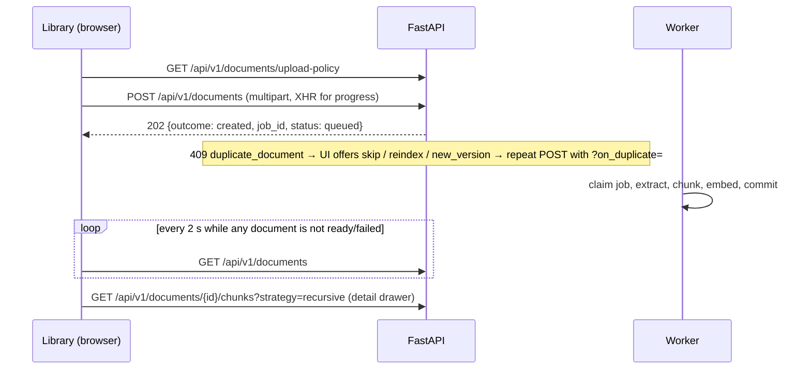
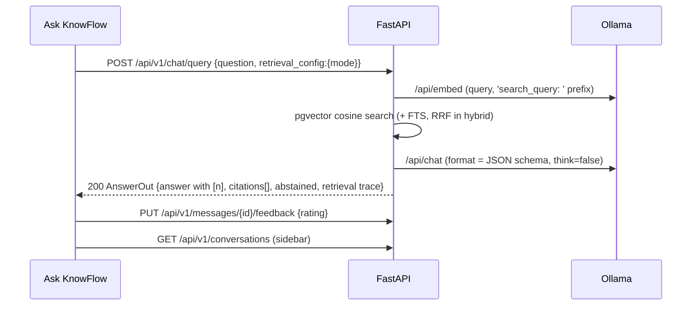
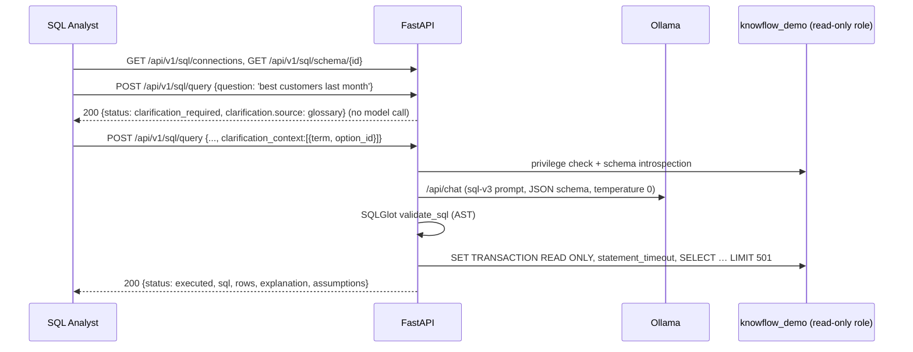
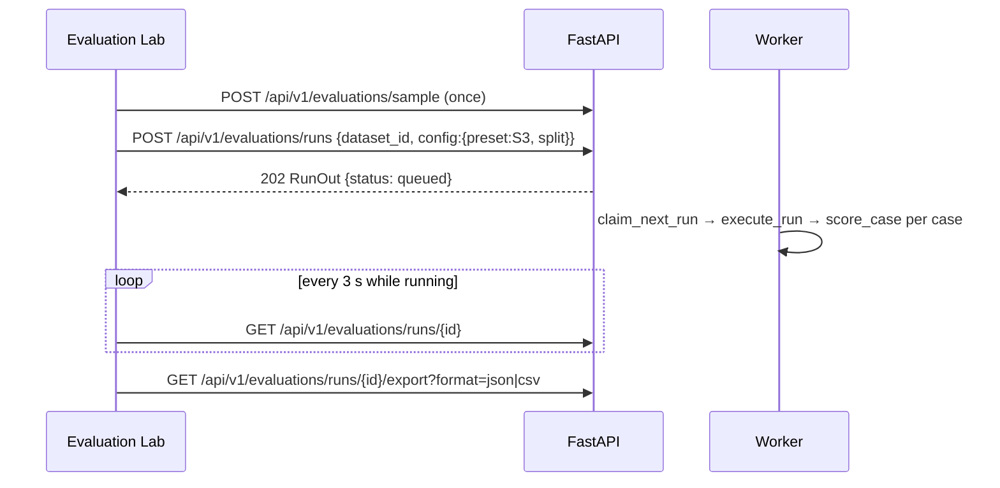

# KnowFlow API Reference

> **Implementation-based.** Every endpoint, parameter, field and status code below is
> generated from the running API's OpenAPI schema (`/api/openapi.json`) and from an AST scan of
> the route handlers in `apps/api/app/api/v1/`. Examples marked *live* are trimmed responses
> recorded from the deployed instance during the A-to-Z check on 2026-11-08.
> Generated from commit `65af69c`. **45 operations, all verified against the live server.**

## Conventions

| Topic | Behaviour (where in the code) |
|---|---|
| Base URL | Browser: same-origin `/api/v1/*`, proxied by Next.js rewrites (`apps/web/next.config.ts`). Direct: `http://127.0.0.1:8000/api/v1`. Interactive docs: `/api/docs`. |
| Authentication | **NOT IMPLEMENTED in the application.** v1 is single-user and local (`modules/workspaces/service.py::get_default_workspace`). The Azure deployment adds HTTP Basic Auth in Caddy in front of the whole site (`deploy/azure/setup.sh`); that is infrastructure, not the API. |
| Workspace scoping | Every handler resolves the default workspace through `api/deps.py::current_workspace`; every content query filters by `workspace_id`. Tested in `tests/integration/test_workspace_isolation.py` and `test_activity_and_security.py`. |
| Request ID | Send `X-Request-ID` (8–64 chars `[A-Za-z0-9._-]`) or one is generated; it is echoed in the response header and in every error body (`core/middleware.py`). |
| Error envelope | `{"error": {"code", "message", "request_id", "fields"?, "details"?}}` from `core/errors.py`. Stack traces are never returned. Validation errors are `422 validation_error` with `fields: [{loc, msg, type}]` (input values are not echoed). DB down → `503 database_unavailable`; schema behind code → `503 schema_not_migrated`. |
| Upload size | `POST /api/v1/documents` is checked by `core/upload_limit.py::UploadSizeLimitMiddleware` before the body is read: no `Content-Length` → `411 length_required`; too big → `413 file_too_large`. |
| Generation concurrency | Chat and SQL share one gate (`modules/models/gate.py`, default 1 at a time, waits up to 10 s): busy → `429 generation_busy`. |
| Model errors | `ModelError` → `503` when retryable (timeout, Ollama down, model missing), `502` otherwise (`rag/service.py`, `sql_assistant/service.py`). |
| Deletes | Idempotent: deleting something that doesn't exist returns `204` (documents, conversations, connections). The demo SQL connection can't be deleted (`409 connection_is_demo`). |

## Endpoint summary

| # | Method | Path | Handler | Success |
|---|---|---|---|---|
| 1 | `GET` | `/api/v1/health/live` | `live` | 200 |
| 2 | `GET` | `/api/v1/health/ready` | `ready` | 200 |
| 3 | `GET` | `/api/v1/workspaces/current` | `get_current_workspace` | 200 |
| 4 | `PATCH` | `/api/v1/workspaces/{workspace_id}` | `update_workspace` | 200 |
| 5 | `GET` | `/api/v1/documents/upload-policy` | `get_upload_policy` | 200 |
| 6 | `POST` | `/api/v1/documents` | `upload_document` | 202, 200 |
| 7 | `GET` | `/api/v1/documents` | `list_documents` | 200 |
| 8 | `GET` | `/api/v1/documents/{document_id}` | `get_document` | 200 |
| 9 | `DELETE` | `/api/v1/documents/{document_id}` | `delete_document` | 204 |
| 10 | `POST` | `/api/v1/documents/{document_id}/retry` | `retry_document` | 202 |
| 11 | `GET` | `/api/v1/documents/{document_id}/chunks` | `list_chunks` | 200 |
| 12 | `GET` | `/api/v1/documents/{document_id}/extraction` | `extraction_preview` | 200 |
| 13 | `GET` | `/api/v1/jobs/{job_id}` | `get_job` | 200 |
| 14 | `GET` | `/api/v1/search` | `search` | 200 |
| 15 | `GET` | `/api/v1/settings/models` | `get_models` | 200 |
| 16 | `PUT` | `/api/v1/settings/models` | `save_models` | 200 |
| 17 | `POST` | `/api/v1/settings/models/validate` | `validate_models` | 200 |
| 18 | `POST` | `/api/v1/settings/reindex` | `reindex` | 202 |
| 19 | `POST` | `/api/v1/chat/query` | `chat_query` | 200 |
| 20 | `GET` | `/api/v1/conversations` | `list_conversations` | 200 |
| 21 | `GET` | `/api/v1/conversations/{conversation_id}` | `get_conversation` | 200 |
| 22 | `PATCH` | `/api/v1/conversations/{conversation_id}` | `rename_conversation` | 200 |
| 23 | `DELETE` | `/api/v1/conversations/{conversation_id}` | `delete_conversation` | 204 |
| 24 | `PUT` | `/api/v1/messages/{message_id}/feedback` | `put_feedback` | 204 |
| 25 | `GET` | `/api/v1/evaluations/datasets` | `list_datasets` | 200 |
| 26 | `POST` | `/api/v1/evaluations/datasets` | `create_dataset` | 201 |
| 27 | `GET` | `/api/v1/evaluations/datasets/{dataset_id}` | `get_dataset` | 200 |
| 28 | `DELETE` | `/api/v1/evaluations/datasets/{dataset_id}` | `delete_dataset` | 204 |
| 29 | `POST` | `/api/v1/evaluations/datasets/{dataset_id}/cases/import` | `import_cases` | 200 |
| 30 | `POST` | `/api/v1/evaluations/sample` | `load_sample` | 202 |
| 31 | `POST` | `/api/v1/evaluations/runs` | `create_run` | 202 |
| 32 | `GET` | `/api/v1/evaluations/runs` | `list_runs` | 200 |
| 33 | `GET` | `/api/v1/evaluations/runs/{run_id}` | `get_run` | 200 |
| 34 | `DELETE` | `/api/v1/evaluations/runs/{run_id}` | `delete_run` | 204 |
| 35 | `GET` | `/api/v1/evaluations/runs/{run_id}/export` | `export_run` | 200 |
| 36 | `GET` | `/api/v1/sql/connections` | `list_connections` | 200 |
| 37 | `POST` | `/api/v1/sql/connections/test` | `test_connection` | 201 |
| 38 | `DELETE` | `/api/v1/sql/connections/{connection_id}` | `delete_connection` | 204 |
| 39 | `GET` | `/api/v1/sql/schema/{connection_id}` | `get_schema` | 200 |
| 40 | `PUT` | `/api/v1/sql/connections/{connection_id}/glossary` | `put_glossary` | 200 |
| 41 | `POST` | `/api/v1/sql/query` | `query` | 200 |
| 42 | `GET` | `/api/v1/sql/connections/{connection_id}/history` | `history` | 200 |
| 43 | `GET` | `/api/v1/activity/events` | `events` | 200 |
| 44 | `GET` | `/api/v1/activity/jobs` | `jobs` | 200 |
| 45 | `GET` | `/api/v1/activity/summary` | `summary` | 200 |

## Endpoints

### 1. `GET /api/v1/health/live`

**Live.**

- **Handler:** `apps/api/app/api/v1/health.py` line 61, `live()`
- **Auth:** none in the app (see Conventions).

**Responses**

| Status | Body |
|---|---|
| 200 | LiveResponse — Successful Response |

**`LiveResponse`**

| Field | Type | Required | Default | Constraints |
|---|---|---|---|---|
| `status` | const ok | yes |  |  |

### 2. `GET /api/v1/health/ready`

**Ready.**

- **Handler:** `apps/api/app/api/v1/health.py` line 70, `ready()`
- **Calls:** `probe`
- **Auth:** none in the app (see Conventions).

**Responses**

| Status | Body |
|---|---|
| 200 | ReadyResponse — Successful Response |
| 503 | ReadyResponse — A required dependency is down |

**`ReadyResponse`**

| Field | Type | Required | Default | Constraints |
|---|---|---|---|---|
| `status` | enum(ready, degraded, not_ready) | yes |  |  |
| `checks` | array<DependencyCheck> | yes |  |  |

**`DependencyCheck`**

| Field | Type | Required | Default | Constraints |
|---|---|---|---|---|
| `name` | string | yes |  |  |
| `state` | enum(ok, unavailable, missing) | yes |  |  |
| `required` | boolean | yes |  |  |
| `detail` | string | yes |  |  |
| `remediation` | string \| null | no |  |  |
| `latency_ms` | number \| null | no |  |  |

**Example**

```bash
curl -s http://127.0.0.1:8000/api/v1/health/ready
```

Response (live, trimmed):

```json
{
  "status": "ready",
  "checks": [
    {"name": "postgres", "state": "ok", "required": true, "detail": "PostgreSQL 16.15 (Debian 16.15-1.pgdg12+2)", "latency_ms": 1.8},
    {"name": "pgvector", "state": "ok", "required": true, "detail": "pgvector 0.8.7"},
    {"name": "database_schema", "state": "ok", "required": true, "detail": "Schema at revision 0007."},
    {"name": "ollama", "state": "ok", "required": true, "detail": "Ollama 0.40.15", "latency_ms": 44.6},
    {"name": "generation_model", "state": "ok", "required": false, "detail": "qwen3:4b is installed."},
    {"name": "embedding_model", "state": "ok", "required": false, "detail": "nomic-embed-text:v1.5 is installed."},
    {"name": "ingestion_worker", "state": "ok", "required": false, "detail": "Ingestion worker running (pid 8861)."}
  ]
}
```

Returns **503** with the same body shape when a *required* check fails, so the UI can still show which dependency is down and its `remediation` command.

### 3. `GET /api/v1/workspaces/current`

**Get Current Workspace.**

- **Handler:** `apps/api/app/api/v1/workspaces.py` line 17, `get_current_workspace()`
- **Calls:** `WorkspaceOut.model_validate`
- **Auth:** none in the app (see Conventions).

**Responses**

| Status | Body |
|---|---|
| 200 | WorkspaceOut — Successful Response |

**`WorkspaceOut`**

| Field | Type | Required | Default | Constraints |
|---|---|---|---|---|
| `id` | string (uuid) | yes |  |  |
| `name` | string | yes |  |  |
| `is_default` | boolean | yes |  |  |
| `created_at` | string (date-time) | yes |  |  |
| `updated_at` | string (date-time) | yes |  |  |

### 4. `PATCH /api/v1/workspaces/{workspace_id}`

**Update Workspace.**

- **Handler:** `apps/api/app/api/v1/workspaces.py` line 26, `update_workspace()`
- **Calls:** `WorkspaceOut.model_validate`, `audit_commit`, `rename_workspace`
- **Auth:** none in the app (see Conventions).

| Parameter | In | Type | Required | Default | Constraints |
|---|---|---|---|---|---|
| `workspace_id` | path | string (uuid) | yes |  |  |

**Request body** (`application/json`)

**`WorkspaceUpdate`**

| Field | Type | Required | Default | Constraints |
|---|---|---|---|---|
| `name` | string | yes |  | min len 1, max len 80 |


**Responses**

| Status | Body |
|---|---|
| 200 | WorkspaceOut — Successful Response |
| 404 | ErrorResponse — Not Found |
| 422 | HTTPValidationError — Validation Error |

**`WorkspaceOut`**

| Field | Type | Required | Default | Constraints |
|---|---|---|---|---|
| `id` | string (uuid) | yes |  |  |
| `name` | string | yes |  |  |
| `is_default` | boolean | yes |  |  |
| `created_at` | string (date-time) | yes |  |  |
| `updated_at` | string (date-time) | yes |  |  |

### 5. `GET /api/v1/documents/upload-policy`

**Get Upload Policy.** What the upload UI shows before a file is chosen (PRD §5.2).

- **Handler:** `apps/api/app/api/v1/documents.py` line 41, `get_upload_policy()`
- **Auth:** none in the app (see Conventions).

**Responses**

| Status | Body |
|---|---|
| 200 | UploadPolicyOut — Successful Response |

**`UploadPolicyOut`**

| Field | Type | Required | Default | Constraints |
|---|---|---|---|---|
| `max_bytes` | integer | yes |  |  |
| `formats` | array<SupportedFormatOut> | yes |  |  |

**`SupportedFormatOut`**

| Field | Type | Required | Default | Constraints |
|---|---|---|---|---|
| `file_type` | enum(pdf, docx, txt, md) | yes |  |  |
| `label` | string | yes |  |  |
| `mime_type` | string | yes |  |  |
| `extensions` | array<string> | yes |  |  |

### 6. `POST /api/v1/documents`

**Upload Document.**

- **Handler:** `apps/api/app/api/v1/documents.py` line 63, `upload_document()`
- **Calls:** `audit_commit`, `repository.latest_jobs`, `service.to_document_out`, `service.upload_document`
- **Auth:** none in the app (see Conventions).

| Parameter | In | Type | Required | Default | Constraints |
|---|---|---|---|---|---|
| `on_duplicate` | query | enum(skip, reindex, new_version) \| null | no |  |  |

**Request body** (`multipart/form-data`)

**`Body_upload_document_api_v1_documents_post`**

| Field | Type | Required | Default | Constraints |
|---|---|---|---|---|
| `file` | string | yes |  |  |


**Responses**

| Status | Body |
|---|---|
| 202 | UploadResult — Successful Response |
| 200 | UploadResult — Duplicate skipped |
| 409 | ErrorResponse — Conflict |
| 411 | ErrorResponse — Length Required |
| 413 | ErrorResponse — Request Entity Too Large |
| 415 | ErrorResponse — Unsupported Media Type |
| 422 | ErrorResponse — Unprocessable Entity |
| 503 | ErrorResponse — Service Unavailable |

**`UploadResult`**

| Field | Type | Required | Default | Constraints |
|---|---|---|---|---|
| `outcome` | enum(created, new_version, reindexed, skipped) | yes |  |  |
| `document_id` | string (uuid) | yes |  |  |
| `job_id` | string (uuid) \| null | yes |  |  |
| `status` | enum(queued, extracting, chunking, embedding, ready, failed) | yes |  |  |
| `document` | DocumentOut | yes |  |  |

**`DocumentOut`**

| Field | Type | Required | Default | Constraints |
|---|---|---|---|---|
| `id` | string (uuid) | yes |  |  |
| `original_name` | string | yes |  |  |
| `file_type` | enum(pdf, docx, txt, md) | yes |  |  |
| `mime_type` | string | yes |  |  |
| `size_bytes` | integer | yes |  |  |
| `sha256` | string | yes |  |  |
| `version` | integer | yes |  |  |
| `status` | enum(queued, extracting, chunking, embedding, ready, failed) | yes |  |  |
| `page_count` | integer \| null | yes |  |  |
| `chunk_count` | integer \| null | yes |  |  |
| `extracted_char_count` | integer \| null | yes |  |  |
| `citation_granularity` | enum(page, section, document) \| null | yes |  |  |
| `last_error` | SafeError \| null | yes |  |  |
| `latest_job` | app__schemas__documents__JobOut \| null | yes |  |  |
| `created_at` | string (date-time) | yes |  |  |
| `updated_at` | string (date-time) | yes |  |  |

**`SafeError`**

| Field | Type | Required | Default | Constraints |
|---|---|---|---|---|
| `code` | string | yes |  |  |
| `message` | string | yes |  |  |

**`app__schemas__documents__JobOut`**

| Field | Type | Required | Default | Constraints |
|---|---|---|---|---|
| `id` | string (uuid) | yes |  |  |
| `document_id` | string (uuid) | yes |  |  |
| `status` | enum(queued, running, succeeded, failed) | yes |  |  |
| `stage` | enum(extracting, chunking, embedding) \| null | yes |  |  |
| `attempts` | integer | yes |  |  |
| `error_code` | string \| null | yes |  |  |
| `error_message_safe` | string \| null | yes |  |  |
| `created_at` | string (date-time) | yes |  |  |
| `started_at` | string (date-time) \| null | yes |  |  |
| `completed_at` | string (date-time) \| null | yes |  |  |

**Example**

```bash
curl -s -X POST http://127.0.0.1:8000/api/v1/documents \n  -F "file=@samples/documents/travel-and-expenses-policy.md;type=text/markdown"
```

Response:

```json
{
  "outcome": "created",
  "document_id": "<uuid>",
  "job_id": "<uuid>",
  "status": "queued",
  "document": { "id": "<uuid>", "original_name": "travel-and-expenses-policy.md", "file_type": "md", "status": "queued", "version": 1, "...": "..." }
}
```

Uploading identical bytes again returns **409** `duplicate_document` with `details.choices = ["skip", "reindex", "new_version"]`; repeat with `?on_duplicate=skip` (→ 200, `outcome: skipped`). A `.pdf` whose bytes aren't a PDF returns **415** `signature_mismatch` (observed live: an `MZ…` file named `evil.pdf` was rejected with 415).

### 7. `GET /api/v1/documents`

**List Documents.**

- **Handler:** `apps/api/app/api/v1/documents.py` line 110, `list_documents()`
- **Calls:** `counts.get`, `jobs.get`, `repository.chunk_counts`, `repository.latest_jobs`, `repository.list_documents`, `service.to_document_out`
- **Auth:** none in the app (see Conventions).

| Parameter | In | Type | Required | Default | Constraints |
|---|---|---|---|---|---|
| `status` | query | enum(queued, extracting, chunking, embedding, ready, failed) \| null | no |  |  |
| `limit` | query | integer | no | 50 | ≥ 1, ≤ 100 |
| `offset` | query | integer | no | 0 | ≥ 0, ≤ 1000000 |

**Responses**

| Status | Body |
|---|---|
| 200 | Page_DocumentOut_ — Successful Response |
| 422 | HTTPValidationError — Validation Error |

**`Page_DocumentOut_`**

| Field | Type | Required | Default | Constraints |
|---|---|---|---|---|
| `items` | array<DocumentOut> | yes |  |  |
| `total` | integer | yes |  |  |
| `limit` | integer | yes |  |  |
| `offset` | integer | yes |  |  |

**`DocumentOut`**

| Field | Type | Required | Default | Constraints |
|---|---|---|---|---|
| `id` | string (uuid) | yes |  |  |
| `original_name` | string | yes |  |  |
| `file_type` | enum(pdf, docx, txt, md) | yes |  |  |
| `mime_type` | string | yes |  |  |
| `size_bytes` | integer | yes |  |  |
| `sha256` | string | yes |  |  |
| `version` | integer | yes |  |  |
| `status` | enum(queued, extracting, chunking, embedding, ready, failed) | yes |  |  |
| `page_count` | integer \| null | yes |  |  |
| `chunk_count` | integer \| null | yes |  |  |
| `extracted_char_count` | integer \| null | yes |  |  |
| `citation_granularity` | enum(page, section, document) \| null | yes |  |  |
| `last_error` | SafeError \| null | yes |  |  |
| `latest_job` | app__schemas__documents__JobOut \| null | yes |  |  |
| `created_at` | string (date-time) | yes |  |  |
| `updated_at` | string (date-time) | yes |  |  |

**`SafeError`**

| Field | Type | Required | Default | Constraints |
|---|---|---|---|---|
| `code` | string | yes |  |  |
| `message` | string | yes |  |  |

**`app__schemas__documents__JobOut`**

| Field | Type | Required | Default | Constraints |
|---|---|---|---|---|
| `id` | string (uuid) | yes |  |  |
| `document_id` | string (uuid) | yes |  |  |
| `status` | enum(queued, running, succeeded, failed) | yes |  |  |
| `stage` | enum(extracting, chunking, embedding) \| null | yes |  |  |
| `attempts` | integer | yes |  |  |
| `error_code` | string \| null | yes |  |  |
| `error_message_safe` | string \| null | yes |  |  |
| `created_at` | string (date-time) | yes |  |  |
| `started_at` | string (date-time) \| null | yes |  |  |
| `completed_at` | string (date-time) \| null | yes |  |  |

### 8. `GET /api/v1/documents/{document_id}`

**Get Document.**

- **Handler:** `apps/api/app/api/v1/documents.py` line 133, `get_document()`
- **Calls:** `repository.get_document`
- **Auth:** none in the app (see Conventions).

| Parameter | In | Type | Required | Default | Constraints |
|---|---|---|---|---|---|
| `document_id` | path | string (uuid) | yes |  |  |

**Responses**

| Status | Body |
|---|---|
| 200 | DocumentOut — Successful Response |
| 404 | ErrorResponse — Not Found |
| 422 | HTTPValidationError — Validation Error |

**`DocumentOut`**

| Field | Type | Required | Default | Constraints |
|---|---|---|---|---|
| `id` | string (uuid) | yes |  |  |
| `original_name` | string | yes |  |  |
| `file_type` | enum(pdf, docx, txt, md) | yes |  |  |
| `mime_type` | string | yes |  |  |
| `size_bytes` | integer | yes |  |  |
| `sha256` | string | yes |  |  |
| `version` | integer | yes |  |  |
| `status` | enum(queued, extracting, chunking, embedding, ready, failed) | yes |  |  |
| `page_count` | integer \| null | yes |  |  |
| `chunk_count` | integer \| null | yes |  |  |
| `extracted_char_count` | integer \| null | yes |  |  |
| `citation_granularity` | enum(page, section, document) \| null | yes |  |  |
| `last_error` | SafeError \| null | yes |  |  |
| `latest_job` | app__schemas__documents__JobOut \| null | yes |  |  |
| `created_at` | string (date-time) | yes |  |  |
| `updated_at` | string (date-time) | yes |  |  |

**`SafeError`**

| Field | Type | Required | Default | Constraints |
|---|---|---|---|---|
| `code` | string | yes |  |  |
| `message` | string | yes |  |  |

**`app__schemas__documents__JobOut`**

| Field | Type | Required | Default | Constraints |
|---|---|---|---|---|
| `id` | string (uuid) | yes |  |  |
| `document_id` | string (uuid) | yes |  |  |
| `status` | enum(queued, running, succeeded, failed) | yes |  |  |
| `stage` | enum(extracting, chunking, embedding) \| null | yes |  |  |
| `attempts` | integer | yes |  |  |
| `error_code` | string \| null | yes |  |  |
| `error_message_safe` | string \| null | yes |  |  |
| `created_at` | string (date-time) | yes |  |  |
| `started_at` | string (date-time) \| null | yes |  |  |
| `completed_at` | string (date-time) \| null | yes |  |  |

**Example**

```bash
curl -s http://127.0.0.1:8000/api/v1/documents/00000000-0000-0000-0000-000000000000
```

Response (live, trimmed):

```json
{"error": {"code": "document_not_found", "message": "This document doesn't exist …", "request_id": "…"}}
```

Example of the 404 error envelope (observed live).

### 9. `DELETE /api/v1/documents/{document_id}`

**Delete Document.** Idempotent: deleting a missing (or foreign-workspace) document also returns 204.

- **Handler:** `apps/api/app/api/v1/documents.py` line 223, `delete_document()`
- **Calls:** `audit_commit`, `service.delete_document`
- **Auth:** none in the app (see Conventions).

| Parameter | In | Type | Required | Default | Constraints |
|---|---|---|---|---|---|
| `document_id` | path | string (uuid) | yes |  |  |

**Responses**

| Status | Body |
|---|---|
| 204 | (empty) — Successful Response |
| 422 | HTTPValidationError — Validation Error |

### 10. `POST /api/v1/documents/{document_id}/retry`

**Retry Document.** Queue processing again (failed ingestion, or a manual re-index). Idempotent.

- **Handler:** `apps/api/app/api/v1/documents.py` line 154, `retry_document()`
- **Calls:** `audit_commit`, `repository.get_document`, `service.retry_document`
- **Auth:** none in the app (see Conventions).

| Parameter | In | Type | Required | Default | Constraints |
|---|---|---|---|---|---|
| `document_id` | path | string (uuid) | yes |  |  |

**Responses**

| Status | Body |
|---|---|
| 202 | DocumentOut — Successful Response |
| 404 | ErrorResponse — Not Found |
| 422 | HTTPValidationError — Validation Error |

**`DocumentOut`**

| Field | Type | Required | Default | Constraints |
|---|---|---|---|---|
| `id` | string (uuid) | yes |  |  |
| `original_name` | string | yes |  |  |
| `file_type` | enum(pdf, docx, txt, md) | yes |  |  |
| `mime_type` | string | yes |  |  |
| `size_bytes` | integer | yes |  |  |
| `sha256` | string | yes |  |  |
| `version` | integer | yes |  |  |
| `status` | enum(queued, extracting, chunking, embedding, ready, failed) | yes |  |  |
| `page_count` | integer \| null | yes |  |  |
| `chunk_count` | integer \| null | yes |  |  |
| `extracted_char_count` | integer \| null | yes |  |  |
| `citation_granularity` | enum(page, section, document) \| null | yes |  |  |
| `last_error` | SafeError \| null | yes |  |  |
| `latest_job` | app__schemas__documents__JobOut \| null | yes |  |  |
| `created_at` | string (date-time) | yes |  |  |
| `updated_at` | string (date-time) | yes |  |  |

**`SafeError`**

| Field | Type | Required | Default | Constraints |
|---|---|---|---|---|
| `code` | string | yes |  |  |
| `message` | string | yes |  |  |

**`app__schemas__documents__JobOut`**

| Field | Type | Required | Default | Constraints |
|---|---|---|---|---|
| `id` | string (uuid) | yes |  |  |
| `document_id` | string (uuid) | yes |  |  |
| `status` | enum(queued, running, succeeded, failed) | yes |  |  |
| `stage` | enum(extracting, chunking, embedding) \| null | yes |  |  |
| `attempts` | integer | yes |  |  |
| `error_code` | string \| null | yes |  |  |
| `error_message_safe` | string \| null | yes |  |  |
| `created_at` | string (date-time) | yes |  |  |
| `started_at` | string (date-time) \| null | yes |  |  |
| `completed_at` | string (date-time) \| null | yes |  |  |

### 11. `GET /api/v1/documents/{document_id}/chunks`

**List Chunks.** Chunk inspection (PRD §5.2, DRD §7.2 document drawer).

- **Handler:** `apps/api/app/api/v1/documents.py` line 171, `list_chunks()`
- **Calls:** `ChunkOut.model_validate`, `repository.get_document`, `repository.list_chunks`
- **Auth:** none in the app (see Conventions).

| Parameter | In | Type | Required | Default | Constraints |
|---|---|---|---|---|---|
| `document_id` | path | string (uuid) | yes |  |  |
| `strategy` | query | enum(fixed, recursive) | no | "recursive" |  |
| `limit` | query | integer | no | 50 | ≥ 1, ≤ 100 |
| `offset` | query | integer | no | 0 | ≥ 0, ≤ 1000000 |

**Responses**

| Status | Body |
|---|---|
| 200 | Page_ChunkOut_ — Successful Response |
| 404 | ErrorResponse — Not Found |
| 422 | HTTPValidationError — Validation Error |

**`Page_ChunkOut_`**

| Field | Type | Required | Default | Constraints |
|---|---|---|---|---|
| `items` | array<ChunkOut> | yes |  |  |
| `total` | integer | yes |  |  |
| `limit` | integer | yes |  |  |
| `offset` | integer | yes |  |  |

**`ChunkOut`**

| Field | Type | Required | Default | Constraints |
|---|---|---|---|---|
| `id` | string (uuid) | yes |  |  |
| `document_id` | string (uuid) | yes |  |  |
| `strategy` | enum(fixed, recursive) | yes |  |  |
| `chunk_index` | integer | yes |  |  |
| `text` | string | yes |  |  |
| `page_start` | integer \| null | yes |  |  |
| `page_end` | integer \| null | yes |  |  |
| `section_path` | string \| null | yes |  |  |
| `char_count` | integer | yes |  |  |
| `token_count` | integer | yes |  |  |
| `content_hash` | string | yes |  |  |

### 12. `GET /api/v1/documents/{document_id}/extraction`

**Extraction Preview.** The first extracted pages/sections, truncated, for the document drawer preview.

- **Handler:** `apps/api/app/api/v1/documents.py` line 197, `extraction_preview()`
- **Calls:** `repository.get_document`, `repository.list_sections`
- **Auth:** none in the app (see Conventions).

| Parameter | In | Type | Required | Default | Constraints |
|---|---|---|---|---|---|
| `document_id` | path | string (uuid) | yes |  |  |
| `limit` | query | integer | no | 5 | ≥ 1, ≤ 50 |
| `max_chars` | query | integer | no | 1500 | ≥ 100, ≤ 5000 |

**Responses**

| Status | Body |
|---|---|
| 200 | ExtractionPreviewOut — Successful Response |
| 404 | ErrorResponse — Not Found |
| 422 | HTTPValidationError — Validation Error |

**`ExtractionPreviewOut`**

| Field | Type | Required | Default | Constraints |
|---|---|---|---|---|
| `total_sections` | integer | yes |  |  |
| `sections` | array<SectionOut> | yes |  |  |

**`SectionOut`**

| Field | Type | Required | Default | Constraints |
|---|---|---|---|---|
| `ordinal` | integer | yes |  |  |
| `page_number` | integer \| null | yes |  |  |
| `section_path` | string \| null | yes |  |  |
| `text` | string | yes |  |  |

### 13. `GET /api/v1/jobs/{job_id}`

**Get Job.**

- **Handler:** `apps/api/app/api/v1/jobs.py` line 16, `get_job()`
- **Calls:** `JobOut.model_validate`, `repository.get_job`
- **Auth:** none in the app (see Conventions).

| Parameter | In | Type | Required | Default | Constraints |
|---|---|---|---|---|---|
| `job_id` | path | string (uuid) | yes |  |  |

**Responses**

| Status | Body |
|---|---|
| 200 | app__schemas__documents__JobOut — Successful Response |
| 404 | ErrorResponse — Not Found |
| 422 | HTTPValidationError — Validation Error |

**`app__schemas__documents__JobOut`**

| Field | Type | Required | Default | Constraints |
|---|---|---|---|---|
| `id` | string (uuid) | yes |  |  |
| `document_id` | string (uuid) | yes |  |  |
| `status` | enum(queued, running, succeeded, failed) | yes |  |  |
| `stage` | enum(extracting, chunking, embedding) \| null | yes |  |  |
| `attempts` | integer | yes |  |  |
| `error_code` | string \| null | yes |  |  |
| `error_message_safe` | string \| null | yes |  |  |
| `created_at` | string (date-time) | yes |  |  |
| `started_at` | string (date-time) \| null | yes |  |  |
| `completed_at` | string (date-time) \| null | yes |  |  |

### 14. `GET /api/v1/search`

**Search.**

- **Handler:** `apps/api/app/api/v1/search.py` line 22, `search()`
- **Calls:** `active_embedding_version`, `asdict`, `dense_search`, `embedder.embed_query`, `lexical_search`, `query_embedder`
- **Auth:** none in the app (see Conventions).

| Parameter | In | Type | Required | Default | Constraints |
|---|---|---|---|---|---|
| `q` | query | string | yes |  | min len 1, max len 500 |
| `strategy` | query | enum(fixed, recursive) | no | "recursive" |  |
| `mode` | query | enum(lexical, dense) | no | "lexical" |  |
| `limit` | query | integer | no | 10 | ≥ 1, ≤ 50 |

**Responses**

| Status | Body |
|---|---|
| 200 | SearchResponse — Successful Response |
| 422 | HTTPValidationError — Validation Error |

**`SearchResponse`**

| Field | Type | Required | Default | Constraints |
|---|---|---|---|---|
| `query` | string | yes |  |  |
| `mode` | enum(lexical, dense, hybrid) | yes |  |  |
| `strategy` | enum(fixed, recursive) | yes |  |  |
| `hits` | array<SearchHit> | yes |  |  |

**`SearchHit`**

| Field | Type | Required | Default | Constraints |
|---|---|---|---|---|
| `chunk_id` | string (uuid) | yes |  |  |
| `document_id` | string (uuid) | yes |  |  |
| `document_name` | string | yes |  |  |
| `text` | string | yes |  |  |
| `page_start` | integer \| null | yes |  |  |
| `page_end` | integer \| null | yes |  |  |
| `section_path` | string \| null | yes |  |  |
| `score` | number | yes |  |  |
| `ranks` | object | yes |  |  |

**Example**

```bash
curl -s "http://127.0.0.1:8000/api/v1/search?q=annual%20leave&mode=lexical&limit=2"
```

Response (live, trimmed):

```json
{
  "query": "annual leave",
  "mode": "lexical",
  "strategy": "recursive",
  "hits": [
    {
      "chunk_id": "3b5e5e9c-…",
      "document_id": "5e05eb6f-…",
      "document_name": "employee-handbook-2026.md",
      "text": "Full-time employees receive 26 days of paid annual leave per calendar year. …",
      "...": "page_start, page_end, section_path, score, ranks"
    }
  ]
}
```

`mode` accepts only `dense` or `lexical` here (hybrid is a chat/evaluation option). `mode=hybrid` → **422** `validation_error` with `fields[0].msg = "Input should be 'lexical' or 'dense'"` (observed live).

### 15. `GET /api/v1/settings/models`

**Get Models.**

- **Handler:** `apps/api/app/api/v1/settings.py` line 21, `get_models()`
- **Calls:** `service.describe`
- **Auth:** none in the app (see Conventions).

**Responses**

| Status | Body |
|---|---|
| 200 | ModelSettingsOut — Successful Response |

**`ModelSettingsOut`**

| Field | Type | Required | Default | Constraints |
|---|---|---|---|---|
| `runtime` | RuntimeOut | yes |  |  |
| `installed` | array<InstalledModelOut> | yes |  |  |
| `generation_model` | string | yes |  |  |
| `embedding_model` | string | yes |  |  |
| `reranker` | RerankerOut | yes |  |  |
| `active_embedding` | EmbeddingVersionOut \| null | yes |  |  |
| `documents_needing_reindex` | integer | yes |  |  |
| `setup_commands` | array<string> | yes |  |  |

**`RuntimeOut`**

| Field | Type | Required | Default | Constraints |
|---|---|---|---|---|
| `reachable` | boolean | yes |  |  |
| `version` | string \| null | yes |  |  |
| `base_url` | string | yes |  |  |
| `error` | string \| null | no |  |  |

**`InstalledModelOut`**

| Field | Type | Required | Default | Constraints |
|---|---|---|---|---|
| `name` | string | yes |  |  |
| `digest` | string | yes |  |  |
| `size_bytes` | integer | yes |  |  |
| `family` | string \| null | yes |  |  |
| `parameter_size` | string \| null | yes |  |  |
| `quantization` | string \| null | yes |  |  |
| `kind` | enum(generation, embedding, unknown) | yes |  |  |

**`RerankerOut`**

| Field | Type | Required | Default | Constraints |
|---|---|---|---|---|
| `enabled` | boolean | yes |  |  |
| `available` | boolean | yes |  |  |
| `model` | string | yes |  |  |
| `note` | string | yes |  |  |

**`EmbeddingVersionOut`**

| Field | Type | Required | Default | Constraints |
|---|---|---|---|---|
| `model` | string | yes |  |  |
| `digest` | string | yes |  |  |
| `dimension` | integer | yes |  |  |
| `created_at` | string (date-time) | yes |  |  |

### 16. `PUT /api/v1/settings/models`

**Save Models.**

- **Handler:** `apps/api/app/api/v1/settings.py` line 36, `save_models()`
- **Calls:** `audit_commit`, `service.describe`, `service.save`
- **Auth:** none in the app (see Conventions).

**Request body** (`application/json`)

**`SaveRequest`**

| Field | Type | Required | Default | Constraints |
|---|---|---|---|---|
| `generation_model` | string | yes |  | min len 1, max len 200 |
| `embedding_model` | string | yes |  | min len 1, max len 200 |
| `reranker_enabled` | boolean | no | false |  |


**Responses**

| Status | Body |
|---|---|
| 200 | SaveResponse — Successful Response |
| 422 | HTTPValidationError — Validation Error |

**`SaveResponse`**

| Field | Type | Required | Default | Constraints |
|---|---|---|---|---|
| `settings` | ModelSettingsOut | yes |  |  |
| `reembed_required` | boolean | yes |  |  |

**`ModelSettingsOut`**

| Field | Type | Required | Default | Constraints |
|---|---|---|---|---|
| `runtime` | RuntimeOut | yes |  |  |
| `installed` | array<InstalledModelOut> | yes |  |  |
| `generation_model` | string | yes |  |  |
| `embedding_model` | string | yes |  |  |
| `reranker` | RerankerOut | yes |  |  |
| `active_embedding` | EmbeddingVersionOut \| null | yes |  |  |
| `documents_needing_reindex` | integer | yes |  |  |
| `setup_commands` | array<string> | yes |  |  |

**`RuntimeOut`**

| Field | Type | Required | Default | Constraints |
|---|---|---|---|---|
| `reachable` | boolean | yes |  |  |
| `version` | string \| null | yes |  |  |
| `base_url` | string | yes |  |  |
| `error` | string \| null | no |  |  |

**`InstalledModelOut`**

| Field | Type | Required | Default | Constraints |
|---|---|---|---|---|
| `name` | string | yes |  |  |
| `digest` | string | yes |  |  |
| `size_bytes` | integer | yes |  |  |
| `family` | string \| null | yes |  |  |
| `parameter_size` | string \| null | yes |  |  |
| `quantization` | string \| null | yes |  |  |
| `kind` | enum(generation, embedding, unknown) | yes |  |  |

**`RerankerOut`**

| Field | Type | Required | Default | Constraints |
|---|---|---|---|---|
| `enabled` | boolean | yes |  |  |
| `available` | boolean | yes |  |  |
| `model` | string | yes |  |  |
| `note` | string | yes |  |  |

**`EmbeddingVersionOut`**

| Field | Type | Required | Default | Constraints |
|---|---|---|---|---|
| `model` | string | yes |  |  |
| `digest` | string | yes |  |  |
| `dimension` | integer | yes |  |  |
| `created_at` | string (date-time) | yes |  |  |

### 17. `POST /api/v1/settings/models/validate`

**Validate Models.** Probe availability, structured output and the real embedding dimension.

- **Handler:** `apps/api/app/api/v1/settings.py` line 28, `validate_models()`
- **Calls:** `service.validate`
- **Auth:** none in the app (see Conventions).

**Request body** (`application/json`)

**`ValidateRequest`**

| Field | Type | Required | Default | Constraints |
|---|---|---|---|---|
| `generation_model` | string | yes |  | min len 1, max len 200 |
| `embedding_model` | string | yes |  | min len 1, max len 200 |
| `probe_generation` | boolean | no | true |  |


**Responses**

| Status | Body |
|---|---|
| 200 | ValidateResponse — Successful Response |
| 422 | HTTPValidationError — Validation Error |

**`ValidateResponse`**

| Field | Type | Required | Default | Constraints |
|---|---|---|---|---|
| `ok` | boolean | yes |  |  |
| `checks` | array<ValidationCheck> | yes |  |  |
| `embedding_dimension` | integer \| null | yes |  |  |
| `embedding_model_changed` | boolean | yes |  |  |

### 18. `POST /api/v1/settings/reindex`

**Reindex.** Queue all documents for processing again, e.g. after changing the embedding model.

- **Handler:** `apps/api/app/api/v1/settings.py` line 57, `reindex()`
- **Calls:** `audit_commit`, `service.reindex_all`
- **Auth:** none in the app (see Conventions).

**Responses**

| Status | Body |
|---|---|
| 202 | ReindexResponse — Successful Response |

**`ReindexResponse`**

| Field | Type | Required | Default | Constraints |
|---|---|---|---|---|
| `queued` | integer | yes |  |  |

### 19. `POST /api/v1/chat/query`

**Chat Query.** Answer from retrieved evidence with verified citations, or abstain. Not streamed (v1).

- **Handler:** `apps/api/app/api/v1/chat.py` line 31, `chat_query()`
- **Calls:** `audit_commit`, `chat_model`, `service.ask`
- **Auth:** none in the app (see Conventions).

**Request body** (`application/json`)

**`ChatQuery`**

| Field | Type | Required | Default | Constraints |
|---|---|---|---|---|
| `conversation_id` | string (uuid) \| null | no |  |  |
| `question` | string | yes |  | min len 1, max len 2000 |
| `document_ids` | array<string (uuid)> \| null | no |  | max items 200 |
| `retrieval_config` | RetrievalConfigIn | no |  |  |

**`RetrievalConfigIn`**

| Field | Type | Required | Default | Constraints |
|---|---|---|---|---|
| `mode` | enum(dense, lexical, hybrid) | no | "dense" |  |
| `strategy` | enum(fixed, recursive) | no | "recursive" |  |
| `top_k` | integer | no | 6 | ≥ 1.0, ≤ 20.0 |
| `rerank` | boolean | no | false |  |


**Responses**

| Status | Body |
|---|---|
| 200 | AnswerOut — Successful Response |
| 404 | ErrorResponse — Not Found |
| 409 | ErrorResponse — Conflict |
| 422 | ErrorResponse — Unprocessable Entity |
| 429 | ErrorResponse — Too Many Requests |
| 502 | ErrorResponse — Bad Gateway |
| 503 | ErrorResponse — Service Unavailable |

**`AnswerOut`**

| Field | Type | Required | Default | Constraints |
|---|---|---|---|---|
| `conversation_id` | string (uuid) | yes |  |  |
| `message_id` | string (uuid) | yes |  |  |
| `answer` | string | yes |  |  |
| `citations` | array<CitationOut> | yes |  |  |
| `abstained` | boolean | yes |  |  |
| `abstain_reason` | string \| null | yes |  |  |
| `retrieval` | RetrievalTrace | yes |  |  |
| `model` | string \| null | yes |  |  |
| `prompt_version` | string | yes |  |  |
| `latency_ms` | integer | yes |  |  |
| `request_id` | string \| null | yes |  |  |

**`CitationOut`**

| Field | Type | Required | Default | Constraints |
|---|---|---|---|---|
| `number` | integer | yes |  |  |
| `chunk_id` | string (uuid) | yes |  |  |
| `document_id` | string (uuid) | yes |  |  |
| `document_name` | string | yes |  |  |
| `page_start` | integer \| null | yes |  |  |
| `page_end` | integer \| null | yes |  |  |
| `section_path` | string \| null | yes |  |  |
| `excerpt` | string | yes |  |  |

**`RetrievalTrace`**

| Field | Type | Required | Default | Constraints |
|---|---|---|---|---|
| `mode` | string | yes |  |  |
| `strategy` | string | yes |  |  |
| `top_k` | integer | yes |  |  |
| `candidates` | integer | yes |  |  |
| `sources_supplied` | integer | yes |  |  |
| `reranked` | boolean | no | false |  |
| `timings_ms` | object | yes |  |  |
| `candidate_ranks` | array<object> | no |  |  |

**Example**

```bash
curl -s -X POST http://127.0.0.1:8000/api/v1/chat/query \n  -H 'Content-Type: application/json' \n  -d '{"question": "What is the hotel cap per night?"}'
```

Response (live, trimmed):

```json
{
  "conversation_id": "<uuid>",
  "message_id": "<uuid>",
  "answer": "Hotels are capped at 150 EUR per night in most cities, with a higher cap of 220 EUR per night in London … [1]",
  "citations": [{"number": 1, "document_name": "travel-and-expenses-policy.md", "section_path": "…", "excerpt": "…", "chunk_id": "…", "document_id": "…", "page_start": null, "page_end": null}],
  "abstained": false,
  "abstain_reason": null,
  "retrieval": {"mode": "dense", "strategy": "recursive", "top_k": 6, "candidates": 6, "sources_supplied": 6, "reranked": false,
                "timings_ms": {"embed_query": 37, "dense": 4, "generation": 5813}, "candidate_ranks": ["…"]},
  "model": "qwen3:4b",
  "prompt_version": "rag-answer-v2",
  "latency_ms": "…"
}
```

Off-topic question ("What is the capital of Mongolia?") → `abstained: true` (observed live, ~31 s). The timings above are from a live call on the Azure VM (4 vCPU).

### 20. `GET /api/v1/conversations`

**List Conversations.**

- **Handler:** `apps/api/app/api/v1/chat.py` line 52, `list_conversations()`
- **Calls:** `service.list_conversations`
- **Auth:** none in the app (see Conventions).

| Parameter | In | Type | Required | Default | Constraints |
|---|---|---|---|---|---|
| `limit` | query | integer | no | 50 | ≥ 1, ≤ 100 |
| `offset` | query | integer | no | 0 | ≥ 0, ≤ 1000000 |

**Responses**

| Status | Body |
|---|---|
| 200 | Page_ConversationOut_ — Successful Response |
| 422 | HTTPValidationError — Validation Error |

**`Page_ConversationOut_`**

| Field | Type | Required | Default | Constraints |
|---|---|---|---|---|
| `items` | array<ConversationOut> | yes |  |  |
| `total` | integer | yes |  |  |
| `limit` | integer | yes |  |  |
| `offset` | integer | yes |  |  |

**`ConversationOut`**

| Field | Type | Required | Default | Constraints |
|---|---|---|---|---|
| `id` | string (uuid) | yes |  |  |
| `title` | string | yes |  |  |
| `created_at` | string (date-time) | yes |  |  |
| `updated_at` | string (date-time) | yes |  |  |
| `message_count` | integer | yes |  |  |

### 21. `GET /api/v1/conversations/{conversation_id}`

**Get Conversation.**

- **Handler:** `apps/api/app/api/v1/chat.py` line 68, `get_conversation()`
- **Calls:** `service.conversation_detail`, `service.get_conversation`
- **Auth:** none in the app (see Conventions).

| Parameter | In | Type | Required | Default | Constraints |
|---|---|---|---|---|---|
| `conversation_id` | path | string (uuid) | yes |  |  |

**Responses**

| Status | Body |
|---|---|
| 200 | ConversationDetail — Successful Response |
| 404 | ErrorResponse — Not Found |
| 422 | HTTPValidationError — Validation Error |

**`ConversationDetail`**

| Field | Type | Required | Default | Constraints |
|---|---|---|---|---|
| `id` | string (uuid) | yes |  |  |
| `title` | string | yes |  |  |
| `created_at` | string (date-time) | yes |  |  |
| `updated_at` | string (date-time) | yes |  |  |
| `message_count` | integer | yes |  |  |
| `messages` | array<MessageOut> | yes |  |  |

**`MessageOut`**

| Field | Type | Required | Default | Constraints |
|---|---|---|---|---|
| `id` | string (uuid) | yes |  |  |
| `role` | enum(user, assistant) | yes |  |  |
| `content` | string | yes |  |  |
| `citations` | array<CitationOut> | yes |  |  |
| `metadata` | object | yes |  |  |
| `feedback` | FeedbackOut \| null | yes |  |  |
| `created_at` | string (date-time) | yes |  |  |

**`CitationOut`**

| Field | Type | Required | Default | Constraints |
|---|---|---|---|---|
| `number` | integer | yes |  |  |
| `chunk_id` | string (uuid) | yes |  |  |
| `document_id` | string (uuid) | yes |  |  |
| `document_name` | string | yes |  |  |
| `page_start` | integer \| null | yes |  |  |
| `page_end` | integer \| null | yes |  |  |
| `section_path` | string \| null | yes |  |  |
| `excerpt` | string | yes |  |  |

**`FeedbackOut`**

| Field | Type | Required | Default | Constraints |
|---|---|---|---|---|
| `rating` | enum(helpful, not_helpful) | yes |  |  |
| `reason` | string \| null | yes |  |  |

### 22. `PATCH /api/v1/conversations/{conversation_id}`

**Rename Conversation.**

- **Handler:** `apps/api/app/api/v1/chat.py` line 80, `rename_conversation()`
- **Calls:** `audit_commit`, `service.conversation_detail`, `service.get_conversation`
- **Auth:** none in the app (see Conventions).

| Parameter | In | Type | Required | Default | Constraints |
|---|---|---|---|---|---|
| `conversation_id` | path | string (uuid) | yes |  |  |

**Request body** (`application/json`)

**`RenameConversation`**

| Field | Type | Required | Default | Constraints |
|---|---|---|---|---|
| `title` | string | yes |  | min len 1, max len 120 |


**Responses**

| Status | Body |
|---|---|
| 200 | ConversationDetail — Successful Response |
| 404 | ErrorResponse — Not Found |
| 422 | HTTPValidationError — Validation Error |

**`ConversationDetail`**

| Field | Type | Required | Default | Constraints |
|---|---|---|---|---|
| `id` | string (uuid) | yes |  |  |
| `title` | string | yes |  |  |
| `created_at` | string (date-time) | yes |  |  |
| `updated_at` | string (date-time) | yes |  |  |
| `message_count` | integer | yes |  |  |
| `messages` | array<MessageOut> | yes |  |  |

**`MessageOut`**

| Field | Type | Required | Default | Constraints |
|---|---|---|---|---|
| `id` | string (uuid) | yes |  |  |
| `role` | enum(user, assistant) | yes |  |  |
| `content` | string | yes |  |  |
| `citations` | array<CitationOut> | yes |  |  |
| `metadata` | object | yes |  |  |
| `feedback` | FeedbackOut \| null | yes |  |  |
| `created_at` | string (date-time) | yes |  |  |

**`CitationOut`**

| Field | Type | Required | Default | Constraints |
|---|---|---|---|---|
| `number` | integer | yes |  |  |
| `chunk_id` | string (uuid) | yes |  |  |
| `document_id` | string (uuid) | yes |  |  |
| `document_name` | string | yes |  |  |
| `page_start` | integer \| null | yes |  |  |
| `page_end` | integer \| null | yes |  |  |
| `section_path` | string \| null | yes |  |  |
| `excerpt` | string | yes |  |  |

**`FeedbackOut`**

| Field | Type | Required | Default | Constraints |
|---|---|---|---|---|
| `rating` | enum(helpful, not_helpful) | yes |  |  |
| `reason` | string \| null | yes |  |  |

### 23. `DELETE /api/v1/conversations/{conversation_id}`

**Delete Conversation.** Idempotent; deletes messages and feedback with it.

- **Handler:** `apps/api/app/api/v1/chat.py` line 93, `delete_conversation()`
- **Calls:** `audit_commit`, `service.get_conversation`
- **Auth:** none in the app (see Conventions).

| Parameter | In | Type | Required | Default | Constraints |
|---|---|---|---|---|---|
| `conversation_id` | path | string (uuid) | yes |  |  |

**Responses**

| Status | Body |
|---|---|
| 204 | (empty) — Successful Response |
| 422 | HTTPValidationError — Validation Error |

### 24. `PUT /api/v1/messages/{message_id}/feedback`

**Put Feedback.**

- **Handler:** `apps/api/app/api/v1/chat.py` line 113, `put_feedback()`
- **Calls:** `audit_commit`, `service.set_feedback`
- **Auth:** none in the app (see Conventions).

| Parameter | In | Type | Required | Default | Constraints |
|---|---|---|---|---|---|
| `message_id` | path | string (uuid) | yes |  |  |

**Request body** (`application/json`)

**`FeedbackIn`**

| Field | Type | Required | Default | Constraints |
|---|---|---|---|---|
| `rating` | enum(helpful, not_helpful) | yes |  |  |
| `reason` | string \| null | no |  | max len 1000 |


**Responses**

| Status | Body |
|---|---|
| 204 | (empty) — Successful Response |
| 404 | ErrorResponse — Not Found |
| 422 | HTTPValidationError — Validation Error |

### 25. `GET /api/v1/evaluations/datasets`

**List Datasets.**

- **Handler:** `apps/api/app/api/v1/evaluations.py` line 43, `list_datasets()`
- **Calls:** `service.list_datasets`
- **Auth:** none in the app (see Conventions).

**Responses**

| Status | Body |
|---|---|
| 200 | array<DatasetOut> — Successful Response |

**`DatasetOut`**

| Field | Type | Required | Default | Constraints |
|---|---|---|---|---|
| `id` | string (uuid) | yes |  |  |
| `name` | string | yes |  |  |
| `version` | string | yes |  |  |
| `description` | string \| null | yes |  |  |
| `created_at` | string (date-time) | yes |  |  |
| `cases` | integer | yes |  |  |
| `dev_cases` | integer | yes |  |  |
| `test_cases` | integer | yes |  |  |
| `runs` | integer | yes |  |  |
| `missing_documents` | array<string> | yes |  |  |

### 26. `POST /api/v1/evaluations/datasets`

**Create Dataset.**

- **Handler:** `apps/api/app/api/v1/evaluations.py` line 36, `create_dataset()`
- **Calls:** `audit_commit`, `service.create_dataset`, `service.dataset_out`
- **Auth:** none in the app (see Conventions).

**Request body** (`application/json`)

**`DatasetIn`**

| Field | Type | Required | Default | Constraints |
|---|---|---|---|---|
| `name` | string | yes |  | min len 1, max len 120 |
| `version` | string | no | "v1" | min len 1, max len 40 |
| `description` | string \| null | no |  | max len 2000 |


**Responses**

| Status | Body |
|---|---|
| 201 | DatasetOut — Successful Response |
| 409 | ErrorResponse — Conflict |
| 422 | HTTPValidationError — Validation Error |

**`DatasetOut`**

| Field | Type | Required | Default | Constraints |
|---|---|---|---|---|
| `id` | string (uuid) | yes |  |  |
| `name` | string | yes |  |  |
| `version` | string | yes |  |  |
| `description` | string \| null | yes |  |  |
| `created_at` | string (date-time) | yes |  |  |
| `cases` | integer | yes |  |  |
| `dev_cases` | integer | yes |  |  |
| `test_cases` | integer | yes |  |  |
| `runs` | integer | yes |  |  |
| `missing_documents` | array<string> | yes |  |  |

### 27. `GET /api/v1/evaluations/datasets/{dataset_id}`

**Get Dataset.**

- **Handler:** `apps/api/app/api/v1/evaluations.py` line 48, `get_dataset()`
- **Calls:** `service.get_dataset`
- **Auth:** none in the app (see Conventions).

| Parameter | In | Type | Required | Default | Constraints |
|---|---|---|---|---|---|
| `dataset_id` | path | string (uuid) | yes |  |  |

**Responses**

| Status | Body |
|---|---|
| 200 | DatasetDetail — Successful Response |
| 404 | ErrorResponse — Not Found |
| 422 | HTTPValidationError — Validation Error |

**`DatasetDetail`**

| Field | Type | Required | Default | Constraints |
|---|---|---|---|---|
| `id` | string (uuid) | yes |  |  |
| `name` | string | yes |  |  |
| `version` | string | yes |  |  |
| `description` | string \| null | yes |  |  |
| `created_at` | string (date-time) | yes |  |  |
| `cases` | integer | yes |  |  |
| `dev_cases` | integer | yes |  |  |
| `test_cases` | integer | yes |  |  |
| `runs` | integer | yes |  |  |
| `missing_documents` | array<string> | yes |  |  |
| `case_list` | array<CaseOut> | yes |  |  |

**`CaseOut`**

| Field | Type | Required | Default | Constraints |
|---|---|---|---|---|
| `id` | string (uuid) | yes |  |  |
| `external_id` | string | yes |  |  |
| `split` | string | yes |  |  |
| `question` | string | yes |  |  |
| `reference_answer` | string \| null | yes |  |  |
| `answerable` | boolean | yes |  |  |
| `expected_evidence` | array<object> | yes |  |  |
| `tags` | array<string> | yes |  |  |

### 28. `DELETE /api/v1/evaluations/datasets/{dataset_id}`

**Delete Dataset.**

- **Handler:** `apps/api/app/api/v1/evaluations.py` line 53, `delete_dataset()`
- **Calls:** `audit_commit`, `service.delete_dataset`
- **Auth:** none in the app (see Conventions).

| Parameter | In | Type | Required | Default | Constraints |
|---|---|---|---|---|---|
| `dataset_id` | path | string (uuid) | yes |  |  |

**Responses**

| Status | Body |
|---|---|
| 204 | (empty) — Successful Response |
| 422 | HTTPValidationError — Validation Error |

### 29. `POST /api/v1/evaluations/datasets/{dataset_id}/cases/import`

**Import Cases.**

- **Handler:** `apps/api/app/api/v1/evaluations.py` line 64, `import_cases()`
- **Calls:** `audit_commit`, `service.import_cases`
- **Auth:** none in the app (see Conventions).

| Parameter | In | Type | Required | Default | Constraints |
|---|---|---|---|---|---|
| `dataset_id` | path | string (uuid) | yes |  |  |

**Request body** (`multipart/form-data`)

**`Body_import_cases_api_v1_evaluations_datasets__dataset_id__cases_import_post`**

| Field | Type | Required | Default | Constraints |
|---|---|---|---|---|
| `file` | string | yes |  |  |


**Responses**

| Status | Body |
|---|---|
| 200 | ImportSummary — Successful Response |
| 404 | ErrorResponse — Not Found |
| 409 | ErrorResponse — Conflict |
| 422 | HTTPValidationError — Validation Error |

**`ImportSummary`**

| Field | Type | Required | Default | Constraints |
|---|---|---|---|---|
| `imported` | integer | yes |  |  |
| `errors` | array<ImportRowError> | yes |  |  |

**`ImportRowError`**

| Field | Type | Required | Default | Constraints |
|---|---|---|---|---|
| `row` | integer | yes |  |  |
| `message` | string | yes |  |  |

### 30. `POST /api/v1/evaluations/sample`

**Load Sample.** Upload the synthetic sample documents and create the bundled gold set (PRD §5.1).

- **Handler:** `apps/api/app/api/v1/evaluations.py` line 89, `load_sample()`
- **Calls:** `audit_commit`, `service.load_sample`
- **Auth:** none in the app (see Conventions).

**Responses**

| Status | Body |
|---|---|
| 202 | SampleLoaded — Successful Response |

**`SampleLoaded`**

| Field | Type | Required | Default | Constraints |
|---|---|---|---|---|
| `dataset_id` | string (uuid) | yes |  |  |
| `documents_queued` | integer | yes |  |  |
| `documents_existing` | integer | yes |  |  |

**Example**

```bash
curl -s -X POST http://127.0.0.1:8000/api/v1/evaluations/sample
```

Response (live, trimmed):

```json
{"dataset_id": "1f133c03-…", "documents_queued": 0, "documents_existing": 5}
```

Idempotent: documents that already exist are kept, not re-uploaded.

### 31. `POST /api/v1/evaluations/runs`

**Create Run.** Queue a run; the worker executes it in the background.

- **Handler:** `apps/api/app/api/v1/evaluations.py` line 113, `create_run()`
- **Calls:** `audit_commit`, `runner.create_run`, `service.run_out`
- **Auth:** none in the app (see Conventions).

**Request body** (`application/json`)

**`RunIn`**

| Field | Type | Required | Default | Constraints |
|---|---|---|---|---|
| `dataset_id` | string (uuid) | yes |  |  |
| `config` | RunConfigIn | no |  |  |

**`RunConfigIn`**

| Field | Type | Required | Default | Constraints |
|---|---|---|---|---|
| `preset` | enum(S1, S2, S3, S4, custom) | no | "S2" |  |
| `chunk_strategy` | enum(fixed, recursive) | no | "recursive" |  |
| `mode` | enum(dense, lexical, hybrid) | no | "dense" |  |
| `rerank` | boolean | no | false |  |
| `top_k` | integer | no | 5 | ≥ 1.0, ≤ 20.0 |
| `candidates` | integer | no | 20 | ≥ 1.0, ≤ 100.0 |
| `split` | enum(dev, test, all) | no | "all" |  |
| `generate_answers` | boolean | no | false |  |
| `label` | string \| null | no |  | max len 80 |


**Responses**

| Status | Body |
|---|---|
| 202 | RunOut — Successful Response |
| 404 | ErrorResponse — Not Found |
| 409 | ErrorResponse — Conflict |
| 422 | HTTPValidationError — Validation Error |

**`RunOut`**

| Field | Type | Required | Default | Constraints |
|---|---|---|---|---|
| `id` | string (uuid) | yes |  |  |
| `dataset_id` | string (uuid) | yes |  |  |
| `label` | string | yes |  |  |
| `strategy` | string | yes |  |  |
| `model_id` | string \| null | yes |  |  |
| `status` | string | yes |  |  |
| `progress` | integer | yes |  |  |
| `total` | integer | yes |  |  |
| `config` | object | yes |  |  |
| `aggregate_metrics` | object | yes |  |  |
| `error` | string \| null | yes |  |  |
| `created_at` | string (date-time) | yes |  |  |
| `started_at` | string (date-time) \| null | yes |  |  |
| `completed_at` | string (date-time) \| null | yes |  |  |

**Example**

```bash
curl -s -X POST http://127.0.0.1:8000/api/v1/evaluations/runs -H 'Content-Type: application/json' \n  -d '{"dataset_id": "<id>", "config": {"preset": "S3", "split": "dev", "top_k": 5, "generate_answers": false}}'
```

Response:

```json
{"id": "<uuid>", "status": "queued", "progress": 0, "total": 38, "strategy": "S3 recursive + hybrid (RRF)", "aggregate_metrics": {}, "...": "..."}
```

The worker runs it; poll `GET /api/v1/evaluations/runs/{id}` until `status` is `succeeded`, then read `aggregate_metrics` (keys: `recall_at_k`, `precision_at_k`, `mrr`, `ndcg_at_k`, `hit_at_k`, latency percentiles, `failure_categories`).

### 32. `GET /api/v1/evaluations/runs`

**List Runs.**

- **Handler:** `apps/api/app/api/v1/evaluations.py` line 131, `list_runs()`
- **Calls:** `service.list_runs`
- **Auth:** none in the app (see Conventions).

| Parameter | In | Type | Required | Default | Constraints |
|---|---|---|---|---|---|
| `dataset_id` | query | string (uuid) \| null | no |  |  |

**Responses**

| Status | Body |
|---|---|
| 200 | array<RunOut> — Successful Response |
| 422 | HTTPValidationError — Validation Error |

**`RunOut`**

| Field | Type | Required | Default | Constraints |
|---|---|---|---|---|
| `id` | string (uuid) | yes |  |  |
| `dataset_id` | string (uuid) | yes |  |  |
| `label` | string | yes |  |  |
| `strategy` | string | yes |  |  |
| `model_id` | string \| null | yes |  |  |
| `status` | string | yes |  |  |
| `progress` | integer | yes |  |  |
| `total` | integer | yes |  |  |
| `config` | object | yes |  |  |
| `aggregate_metrics` | object | yes |  |  |
| `error` | string \| null | yes |  |  |
| `created_at` | string (date-time) | yes |  |  |
| `started_at` | string (date-time) \| null | yes |  |  |
| `completed_at` | string (date-time) \| null | yes |  |  |

### 33. `GET /api/v1/evaluations/runs/{run_id}`

**Get Run.**

- **Handler:** `apps/api/app/api/v1/evaluations.py` line 138, `get_run()`
- **Calls:** `service.get_run`
- **Auth:** none in the app (see Conventions).

| Parameter | In | Type | Required | Default | Constraints |
|---|---|---|---|---|---|
| `run_id` | path | string (uuid) | yes |  |  |

**Responses**

| Status | Body |
|---|---|
| 200 | RunDetail — Successful Response |
| 404 | ErrorResponse — Not Found |
| 422 | HTTPValidationError — Validation Error |

**`RunDetail`**

| Field | Type | Required | Default | Constraints |
|---|---|---|---|---|
| `id` | string (uuid) | yes |  |  |
| `dataset_id` | string (uuid) | yes |  |  |
| `label` | string | yes |  |  |
| `strategy` | string | yes |  |  |
| `model_id` | string \| null | yes |  |  |
| `status` | string | yes |  |  |
| `progress` | integer | yes |  |  |
| `total` | integer | yes |  |  |
| `config` | object | yes |  |  |
| `aggregate_metrics` | object | yes |  |  |
| `error` | string \| null | yes |  |  |
| `created_at` | string (date-time) | yes |  |  |
| `started_at` | string (date-time) \| null | yes |  |  |
| `completed_at` | string (date-time) \| null | yes |  |  |
| `results` | array<ResultOut> | yes |  |  |

**`ResultOut`**

| Field | Type | Required | Default | Constraints |
|---|---|---|---|---|
| `case_id` | string (uuid) | yes |  |  |
| `external_id` | string | yes |  |  |
| `split` | string | yes |  |  |
| `question` | string | yes |  |  |
| `reference_answer` | string \| null | yes |  |  |
| `answerable` | boolean | yes |  |  |
| `expected_evidence` | array<object> | yes |  |  |
| `tags` | array<string> | yes |  |  |
| `retrieved` | array<object> | yes |  |  |
| `answer` | string \| null | yes |  |  |
| `metrics` | object | yes |  |  |
| `failure_category` | string \| null | yes |  |  |
| `latency_ms` | integer \| null | yes |  |  |
| `error` | string \| null | yes |  |  |

### 34. `DELETE /api/v1/evaluations/runs/{run_id}`

**Delete Run.**

- **Handler:** `apps/api/app/api/v1/evaluations.py` line 164, `delete_run()`
- **Calls:** `audit_commit`, `service.delete_run`
- **Auth:** none in the app (see Conventions).

| Parameter | In | Type | Required | Default | Constraints |
|---|---|---|---|---|---|
| `run_id` | path | string (uuid) | yes |  |  |

**Responses**

| Status | Body |
|---|---|
| 204 | (empty) — Successful Response |
| 409 | ErrorResponse — Conflict |
| 422 | HTTPValidationError — Validation Error |

### 35. `GET /api/v1/evaluations/runs/{run_id}/export`

**Export Run.**

- **Handler:** `apps/api/app/api/v1/evaluations.py` line 143, `export_run()`
- **Calls:** `service.export_run`, `service.get_run`
- **Auth:** none in the app (see Conventions).

| Parameter | In | Type | Required | Default | Constraints |
|---|---|---|---|---|---|
| `run_id` | path | string (uuid) | yes |  |  |
| `format` | query | enum(json, csv) | no | "json" |  |

**Responses**

| Status | Body |
|---|---|
| 200 | Successful Response — Successful Response |
| 404 | ErrorResponse — Not Found |
| 422 | HTTPValidationError — Validation Error |

### 36. `GET /api/v1/sql/connections`

**List Connections.**

- **Handler:** `apps/api/app/api/v1/sql.py` line 28, `list_connections()`
- **Calls:** `service.list_connections`
- **Auth:** none in the app (see Conventions).

**Responses**

| Status | Body |
|---|---|
| 200 | array<ConnectionOut> — Successful Response |

**`ConnectionOut`**

| Field | Type | Required | Default | Constraints |
|---|---|---|---|---|
| `id` | string (uuid) | yes |  |  |
| `display_name` | string | yes |  |  |
| `db_type` | string | yes |  |  |
| `host` | string | yes |  |  |
| `port` | integer | yes |  |  |
| `database_name` | string | yes |  |  |
| `username` | string | yes |  |  |
| `allowed_schemas` | array<string> | yes |  |  |
| `is_demo` | boolean | yes |  |  |
| `created_at` | string (date-time) | yes |  |  |

### 37. `POST /api/v1/sql/connections/test`

**Test Connection.** Connect, verify the role is read-only and save. The password is never returned.

- **Handler:** `apps/api/app/api/v1/sql.py` line 35, `test_connection()`
- **Calls:** `audit_commit`, `service.test_and_save`
- **Auth:** none in the app (see Conventions).

**Request body** (`application/json`)

**`ConnectionIn`**

| Field | Type | Required | Default | Constraints |
|---|---|---|---|---|
| `display_name` | string | yes |  | min len 1, max len 80 |
| `host` | string | yes |  | min len 1, max len 255 |
| `port` | integer | no | 5432 | ≥ 1.0, ≤ 65535.0 |
| `database_name` | string | yes |  |  |
| `username` | string | yes |  |  |
| `password` | string (password) | yes |  | min len 1, max len 200 |
| `allowed_schemas` | array<string> | yes |  | max items 10, min items 1 |


**Responses**

| Status | Body |
|---|---|
| 201 | ConnectionOut — Successful Response |
| 404 | ErrorResponse — Not Found |
| 409 | ErrorResponse — Conflict |
| 422 | ErrorResponse — Unprocessable Entity |
| 503 | ErrorResponse — Service Unavailable |

**`ConnectionOut`**

| Field | Type | Required | Default | Constraints |
|---|---|---|---|---|
| `id` | string (uuid) | yes |  |  |
| `display_name` | string | yes |  |  |
| `db_type` | string | yes |  |  |
| `host` | string | yes |  |  |
| `port` | integer | yes |  |  |
| `database_name` | string | yes |  |  |
| `username` | string | yes |  |  |
| `allowed_schemas` | array<string> | yes |  |  |
| `is_demo` | boolean | yes |  |  |
| `created_at` | string (date-time) | yes |  |  |

### 38. `DELETE /api/v1/sql/connections/{connection_id}`

**Delete Connection.**

- **Handler:** `apps/api/app/api/v1/sql.py` line 54, `delete_connection()`
- **Calls:** `audit_commit`, `service.delete_connection`
- **Auth:** none in the app (see Conventions).

| Parameter | In | Type | Required | Default | Constraints |
|---|---|---|---|---|---|
| `connection_id` | path | string (uuid) | yes |  |  |

**Responses**

| Status | Body |
|---|---|
| 204 | (empty) — Successful Response |
| 404 | ErrorResponse — Not Found |
| 409 | ErrorResponse — Conflict |
| 422 | ErrorResponse — Unprocessable Entity |
| 503 | ErrorResponse — Service Unavailable |

### 39. `GET /api/v1/sql/schema/{connection_id}`

**Get Schema.** Allow-listed tables, columns, types, descriptions and the glossary. No data rows.

- **Handler:** `apps/api/app/api/v1/sql.py` line 63, `get_schema()`
- **Calls:** `service.schema`
- **Auth:** none in the app (see Conventions).

| Parameter | In | Type | Required | Default | Constraints |
|---|---|---|---|---|---|
| `connection_id` | path | string (uuid) | yes |  |  |

**Responses**

| Status | Body |
|---|---|
| 200 | SchemaOut — Successful Response |
| 404 | ErrorResponse — Not Found |
| 409 | ErrorResponse — Conflict |
| 422 | ErrorResponse — Unprocessable Entity |
| 503 | ErrorResponse — Service Unavailable |

**`SchemaOut`**

| Field | Type | Required | Default | Constraints |
|---|---|---|---|---|
| `connection` | ConnectionOut | yes |  |  |
| `tables` | array<TableOut> | yes |  |  |
| `glossary` | array<GlossaryTermIO> | yes |  |  |
| `max_rows` | integer | yes |  |  |
| `statement_timeout_ms` | integer | yes |  |  |

**`ConnectionOut`**

| Field | Type | Required | Default | Constraints |
|---|---|---|---|---|
| `id` | string (uuid) | yes |  |  |
| `display_name` | string | yes |  |  |
| `db_type` | string | yes |  |  |
| `host` | string | yes |  |  |
| `port` | integer | yes |  |  |
| `database_name` | string | yes |  |  |
| `username` | string | yes |  |  |
| `allowed_schemas` | array<string> | yes |  |  |
| `is_demo` | boolean | yes |  |  |
| `created_at` | string (date-time) | yes |  |  |

**`TableOut`**

| Field | Type | Required | Default | Constraints |
|---|---|---|---|---|
| `schema_name` | string | yes |  |  |
| `name` | string | yes |  |  |
| `description` | string \| null | yes |  |  |
| `columns` | array<ColumnOut> | yes |  |  |

**`ColumnOut`**

| Field | Type | Required | Default | Constraints |
|---|---|---|---|---|
| `name` | string | yes |  |  |
| `data_type` | string | yes |  |  |
| `nullable` | boolean | yes |  |  |
| `description` | string \| null | yes |  |  |

**`GlossaryTermIO`**

| Field | Type | Required | Default | Constraints |
|---|---|---|---|---|
| `term` | string | yes |  | min len 1, max len 80 |
| `kind` | enum(definition, ambiguous) | yes |  |  |
| `definition` | string \| null | no |  | max len 1000 |
| `synonyms` | array<string> | no |  | max items 10 |
| `options` | array<GlossaryOption> | no |  | max items 4 |

**`GlossaryOption`**

| Field | Type | Required | Default | Constraints |
|---|---|---|---|---|
| `id` | string | yes |  | min len 1, max len 40 |
| `label` | string | yes |  | min len 1, max len 120 |
| `definition` | string | yes |  | min len 1, max len 500 |

### 40. `PUT /api/v1/sql/connections/{connection_id}/glossary`

**Put Glossary.**

- **Handler:** `apps/api/app/api/v1/sql.py` line 73, `put_glossary()`
- **Calls:** `audit_commit`, `service.save_glossary`
- **Auth:** none in the app (see Conventions).

| Parameter | In | Type | Required | Default | Constraints |
|---|---|---|---|---|---|
| `connection_id` | path | string (uuid) | yes |  |  |

**Request body** (`application/json`)

`array<GlossaryTermIO>`


**Responses**

| Status | Body |
|---|---|
| 200 | array<GlossaryTermIO> — Successful Response |
| 404 | ErrorResponse — Not Found |
| 409 | ErrorResponse — Conflict |
| 422 | ErrorResponse — Unprocessable Entity |
| 503 | ErrorResponse — Service Unavailable |

**`GlossaryTermIO`**

| Field | Type | Required | Default | Constraints |
|---|---|---|---|---|
| `term` | string | yes |  | min len 1, max len 80 |
| `kind` | enum(definition, ambiguous) | yes |  |  |
| `definition` | string \| null | no |  | max len 1000 |
| `synonyms` | array<string> | no |  | max items 10 |
| `options` | array<GlossaryOption> | no |  | max items 4 |

**`GlossaryOption`**

| Field | Type | Required | Default | Constraints |
|---|---|---|---|---|
| `id` | string | yes |  | min len 1, max len 40 |
| `label` | string | yes |  | min len 1, max len 120 |
| `definition` | string | yes |  | min len 1, max len 500 |

### 41. `POST /api/v1/sql/query`

**Query.** Either a clarification (nothing executed) or validated read-only SQL with its result.

- **Handler:** `apps/api/app/api/v1/sql.py` line 92, `query()`
- **Calls:** `audit_commit`, `chat_model`, `service.ask`
- **Auth:** none in the app (see Conventions).

**Request body** (`application/json`)

**`SqlQueryIn`**

| Field | Type | Required | Default | Constraints |
|---|---|---|---|---|
| `connection_id` | string (uuid) | yes |  |  |
| `question` | string | yes |  | min len 1, max len 1000 |
| `clarification_context` | array<ChoiceIn> | no |  | max items 5 |
| `repair` | RepairIn \| null | no |  |  |

**`ChoiceIn`**

| Field | Type | Required | Default | Constraints |
|---|---|---|---|---|
| `term` | string | yes |  | min len 1, max len 80 |
| `option_id` | string \| null | no |  | max len 40 |
| `custom_definition` | string \| null | no |  | max len 500 |

**`RepairIn`**

| Field | Type | Required | Default | Constraints |
|---|---|---|---|---|
| `sql` | string | yes |  | min len 1, max len 10000 |
| `error` | string | yes |  | min len 1, max len 1000 |


**Responses**

| Status | Body |
|---|---|
| 200 | SqlAnswerOut — Successful Response |
| 404 | ErrorResponse — Not Found |
| 409 | ErrorResponse — Conflict |
| 422 | ErrorResponse — Unprocessable Entity |
| 503 | ErrorResponse — Service Unavailable |

**`SqlAnswerOut`**

| Field | Type | Required | Default | Constraints |
|---|---|---|---|---|
| `query_id` | string (uuid) | yes |  |  |
| `status` | enum(clarification_required, executed, rejected, failed, unsupported) | yes |  |  |
| `question` | string | yes |  |  |
| `clarification` | ClarificationOut \| null | no |  |  |
| `sql` | string \| null | no |  |  |
| `explanation` | string \| null | no |  |  |
| `assumptions` | array<string> | no |  |  |
| `definitions_used` | array<object> | no |  |  |
| `tables` | array<string> | no |  |  |
| `columns` | array<string> | no |  |  |
| `rows` | array<array<object>> | no |  |  |
| `row_count` | integer \| null | no |  |  |
| `truncated` | boolean | no | false |  |
| `duration_ms` | integer \| null | no |  |  |
| `generation_ms` | integer \| null | no |  |  |
| `message` | string \| null | no |  |  |
| `repairable` | boolean | no | false |  |
| `model` | string \| null | no |  |  |
| `prompt_version` | string | no | "sql-v3" |  |
| `read_only` | boolean | no | true |  |
| `database` | string \| null | no |  |  |

**`ClarificationOut`**

| Field | Type | Required | Default | Constraints |
|---|---|---|---|---|
| `term` | string | yes |  |  |
| `question` | string | yes |  |  |
| `options` | array<GlossaryOption> | yes |  |  |
| `source` | enum(glossary, model) | yes |  |  |

**`GlossaryOption`**

| Field | Type | Required | Default | Constraints |
|---|---|---|---|---|
| `id` | string | yes |  | min len 1, max len 40 |
| `label` | string | yes |  | min len 1, max len 120 |
| `definition` | string | yes |  | min len 1, max len 500 |

**Example**

```bash
curl -s -X POST http://127.0.0.1:8000/api/v1/sql/query -H 'Content-Type: application/json' \n  -d '{"connection_id": "<demo id>", "question": "Who were our best customers last month?"}'
```

Response (live, trimmed):

```json
{
  "status": "clarification_required",
  "clarification": {
    "term": "best customer",
    "question": "What should “best customer” mean for this question?",
    "options": ["Highest paid revenue", "Most orders", "Highest average order value"],
    "source": "glossary"
  },
  "sql": null, "rows": [], "...": "..."
}
```

This first call made **no model call** (returned in under a second, observed live). Re-sending with `"clarification_context": [{"term": "best customer", "option_id": "<option id>"}]` returned `status: executed`, `read_only: true`, 1 row after ~75 s on the Azure VM. "Delete every order from the orders table" returned `status: unsupported` (observed live). Options are shown here by label; the API returns objects `{id, label, definition}`.

### 42. `GET /api/v1/sql/connections/{connection_id}/history`

**History.**

- **Handler:** `apps/api/app/api/v1/sql.py` line 112, `history()`
- **Calls:** `service.get_connection`, `service.history`
- **Auth:** none in the app (see Conventions).

| Parameter | In | Type | Required | Default | Constraints |
|---|---|---|---|---|---|
| `connection_id` | path | string (uuid) | yes |  |  |

**Responses**

| Status | Body |
|---|---|
| 200 | array<HistoryItem> — Successful Response |
| 404 | ErrorResponse — Not Found |
| 409 | ErrorResponse — Conflict |
| 422 | ErrorResponse — Unprocessable Entity |
| 503 | ErrorResponse — Service Unavailable |

**`HistoryItem`**

| Field | Type | Required | Default | Constraints |
|---|---|---|---|---|
| `id` | string (uuid) | yes |  |  |
| `question` | string | yes |  |  |
| `status` | string | yes |  |  |
| `row_count` | integer \| null | yes |  |  |
| `created_at` | string (date-time) | yes |  |  |

### 43. `GET /api/v1/activity/events`

**Events.**

- **Handler:** `apps/api/app/api/v1/activity.py` line 97, `events()`
- **Calls:** `conditions.append`, `func.count`, `select`
- **Auth:** none in the app (see Conventions).

| Parameter | In | Type | Required | Default | Constraints |
|---|---|---|---|---|---|
| `category` | query | enum(all, document, ingestion, chat, conversation, feedback, settings, evaluation, sql, workspace) | no | "all" |  |
| `limit` | query | integer | no | 50 | ≥ 1, ≤ 200 |
| `offset` | query | integer | no | 0 | ≥ 0 |

**Responses**

| Status | Body |
|---|---|
| 200 | EventPage — Successful Response |
| 422 | HTTPValidationError — Validation Error |

**`EventPage`**

| Field | Type | Required | Default | Constraints |
|---|---|---|---|---|
| `items` | array<EventOut> | yes |  |  |
| `total` | integer | yes |  |  |

**`EventOut`**

| Field | Type | Required | Default | Constraints |
|---|---|---|---|---|
| `id` | string | yes |  |  |
| `created_at` | string (date-time) | yes |  |  |
| `actor` | string | yes |  |  |
| `action` | string | yes |  |  |
| `resource_type` | string | yes |  |  |
| `resource_id` | string \| null | yes |  |  |
| `request_id` | string \| null | yes |  |  |
| `metadata` | object | yes |  |  |

### 44. `GET /api/v1/activity/jobs`

**Jobs.**

- **Handler:** `apps/api/app/api/v1/activity.py` line 134, `jobs()`
- **Calls:** `out.append`, `select`, `stmt.order_by`, `stmt.where`
- **Auth:** none in the app (see Conventions).

| Parameter | In | Type | Required | Default | Constraints |
|---|---|---|---|---|---|
| `status` | query | enum(all, failed, active) | no | "all" |  |
| `limit` | query | integer | no | 50 | ≥ 1, ≤ 200 |

**Responses**

| Status | Body |
|---|---|
| 200 | array<app__api__v1__activity__JobOut> — Successful Response |
| 422 | HTTPValidationError — Validation Error |

**`app__api__v1__activity__JobOut`**

| Field | Type | Required | Default | Constraints |
|---|---|---|---|---|
| `id` | string | yes |  |  |
| `document_id` | string | yes |  |  |
| `document_name` | string | yes |  |  |
| `status` | string | yes |  |  |
| `stage` | string \| null | yes |  |  |
| `attempts` | integer | yes |  |  |
| `error_code` | string \| null | yes |  |  |
| `error_message` | string \| null | yes |  |  |
| `created_at` | string (date-time) | yes |  |  |
| `started_at` | string (date-time) \| null | yes |  |  |
| `completed_at` | string (date-time) \| null | yes |  |  |
| `duration_ms` | integer \| null | yes |  |  |

### 45. `GET /api/v1/activity/summary`

**Summary.**

- **Handler:** `apps/api/app/api/v1/activity.py` line 177, `summary()`
- **Calls:** `agg.get`, `counts.get`, `counts.values`, `datetime.now`, `func.count`, `m.get`, `select`, `statistics.median`, `timedelta`
- **Auth:** none in the app (see Conventions).

**Responses**

| Status | Body |
|---|---|
| 200 | SummaryOut — Successful Response |

**`SummaryOut`**

| Field | Type | Required | Default | Constraints |
|---|---|---|---|---|
| `documents` | integer | yes |  |  |
| `documents_ready` | integer | yes |  |  |
| `documents_processing` | integer | yes |  |  |
| `documents_failed` | integer | yes |  |  |
| `chunks` | integer | yes |  |  |
| `questions_7d` | integer | yes |  |  |
| `abstained_7d` | integer | yes |  |  |
| `answer_latency_p50_ms` | number \| null | yes |  |  |
| `sql_questions_7d` | integer | yes |  |  |
| `latest_evaluation` | LatestRun \| null | yes |  |  |

**`LatestRun`**

| Field | Type | Required | Default | Constraints |
|---|---|---|---|---|
| `id` | string | yes |  |  |
| `label` | string | yes |  |  |
| `status` | string | yes |  |  |
| `recall_at_k` | number \| null | yes |  |  |
| `mrr` | number \| null | yes |  |  |
| `cases` | integer | yes |  |  |
| `created_at` | string (date-time) | yes |  |  |

## API call sequences for the main workflows

### Upload and index a document



### Ask a question



### Ambiguous SQL question



### Evaluation run



